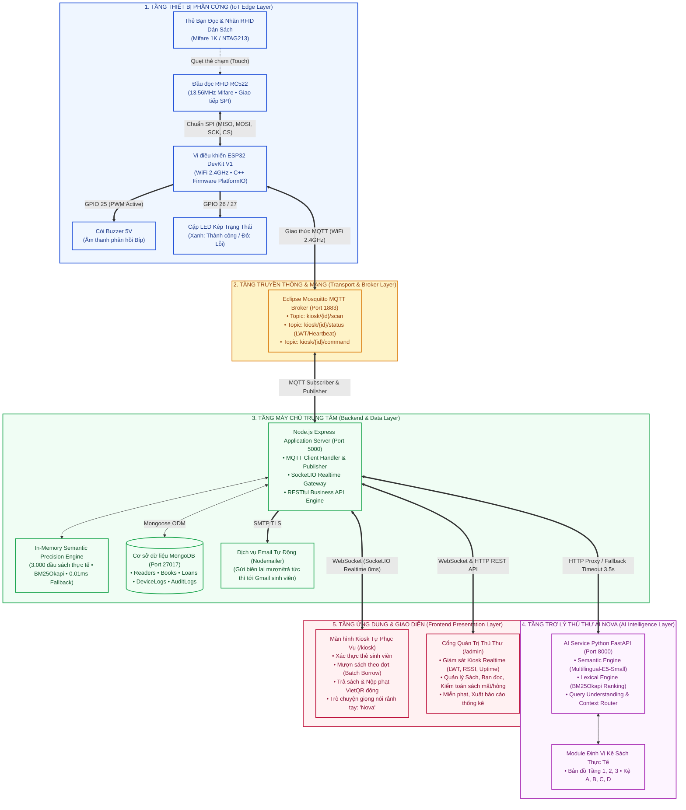
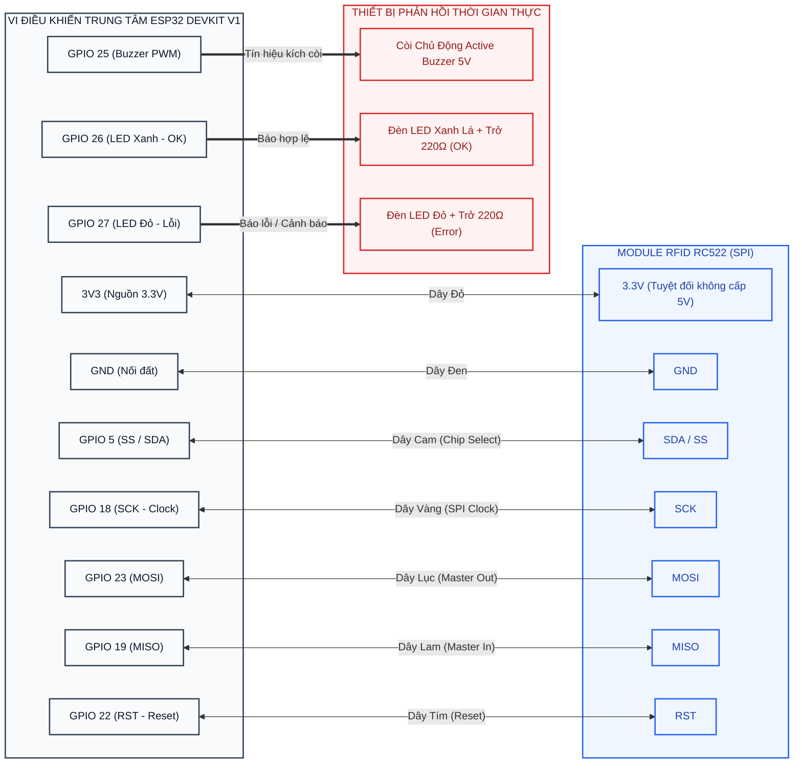
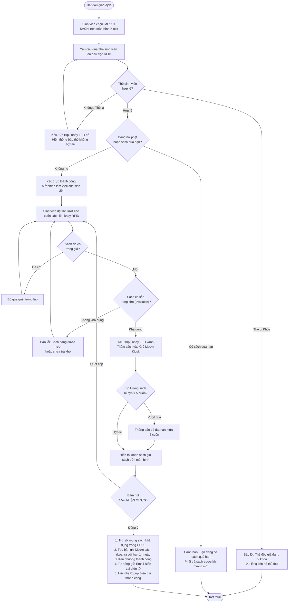
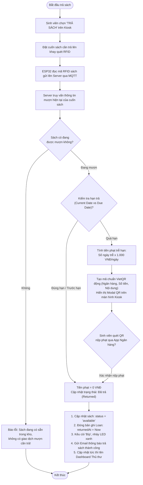
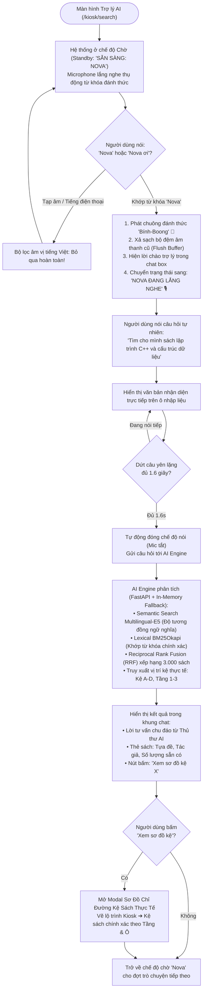
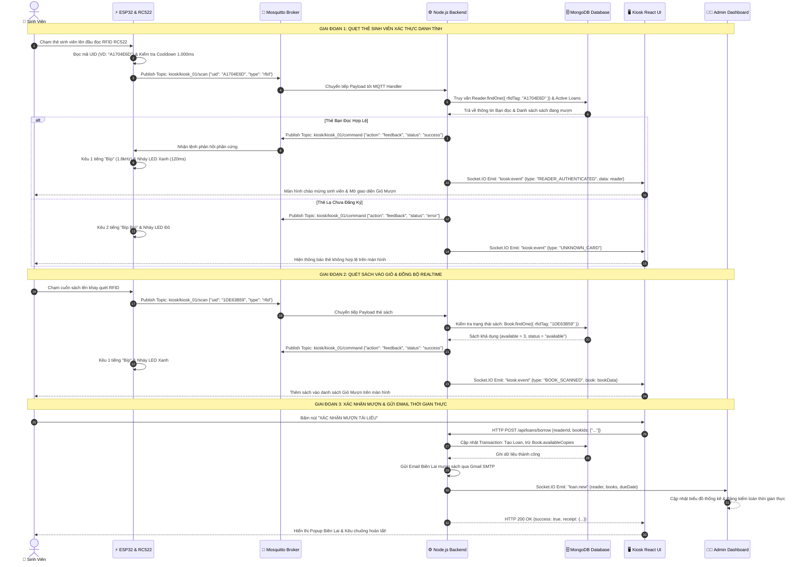

# 📚 HỆ THỐNG SMART LIBRARY KIOSK - TRẠM MƯỢN TRẢ SÁCH TỰ PHỤC VỤ IOT & TRỢ LÝ THỦ THƯ AI (NOVA)

[](https://github.com/DaoDuyHai/btl_iot/actions/workflows/ci.yml)
[](<>)
[](<>)
[](<>)
[](<>)
[](<>)
[](<>)
[](<>)

> **Đề tài tốt nghiệp / Đồ án IoT:** Nghiên cứu, thiết kế và chế tạo Trạm Kiosk Mượn/Trả Sách Tự Phục Vụ Thông Minh ứng dụng công nghệ **IoT (ESP32, RFID RC522, MQTT, WebSocket)** kết hợp **Trợ Lý Thủ Thư AI Rảnh Tay "Nova" (Hands-Free Voice Wake Word, Hybrid Multilingual-E5 + BM25Okapi, Sơ đồ chỉ đường vị trí kệ sách)**.

---

## 🖥️ CÁC ĐỊA CHỈ TRUY CẬP HỆ THỐNG (LOCALHOST)

- 🖥️ **Màn hình Kiosk Tự Phục Vụ:** [http://localhost:5173/kiosk](http://localhost:5173/kiosk)
- 🛡️ **Cổng Quản Trị Thủ Thư (Admin Portal):** [http://localhost:5173/admin](http://localhost:5173/admin)
- ⚙️ **Hạ tầng Backend API (Express + Socket.IO):** [http://localhost:5000/api/health](http://localhost:5000/api/health)
- 🤖 **Tài liệu API Trợ lý AI Nova (FastAPI Swagger Docs):** [http://localhost:8000/docs](http://localhost:8000/docs)

---

## 🏛️ 1. SƠ ĐỒ KIẾN TRÚC TỔNG THỂ HỆ THỐNG (SYSTEM ARCHITECTURE - IOT LEVEL 3)

Hệ thống được thiết kế theo tiêu chuẩn quốc tế **IoT Level 3** (_Bahga & Madisetti_): Nút biên phần cứng (ESP32) chỉ đảm nhiệm việc thu thập mã thẻ RFID và phản hồi còi/LED; toàn bộ dữ liệu, phân tích nghiệp vụ, dịch vụ trí tuệ nhân tạo và giao diện hiển thị được xử lý tập trung trên nền tảng máy chủ.



---

## ⚡ 2. SƠ ĐỒ PHẦN CỨNG & ĐẤU NỐI CHÂN MẠCH (HARDWARE & PINOUT WIRING)

Hệ thống sử dụng vi điều khiển **ESP32 NodeMCU DevKit V1 (30 chân)** kết nối module đầu đọc **RFID RC522 (13.56 MHz)** thông qua giao tiếp chuẩn **SPI (Serial Peripheral Interface)** với tốc độ lấy mẫu cao và độ ổn định tuyệt đối:



### 📋 Bảng Dự Toán Kinh Phí Linh Kiện Phần Cứng Thực Tế (BOM):

|  STT   | Tên Linh Kiện               | Thông Số / Giao Tiếp                | Số Lượng | Đơn Giá Ước Tính | Vai Trò Trong Đề Tài                           |
| :----: | :-------------------------- | :---------------------------------- | :------: | :--------------: | :--------------------------------------------- |
| **1**  | **ESP32 NodeMCU DevKit V1** | 30 chân, 2.4GHz Wi-Fi + BLE         |    1     |   ~65.000 VNĐ    | Nút biên vi điều khiển trung tâm IoT           |
| **2**  | **Module RFID RC522**       | 13.56 MHz, chuẩn giao tiếp SPI      |    1     |   ~28.000 VNĐ    | Đọc mã định danh UID thẻ sinh viên và thẻ sách |
| **3**  | **Thẻ & Nhãn Dán RFID**     | Mifare 1K (Thẻ trắng / Sticker dán) |    5     |   ~15.000 VNĐ    | Gán mã định danh cho bạn đọc & bìa sách        |
| **4**  | **Còi Active Buzzer 5V**    | Tần số âm thanh 1.8kHz              |    1     |    ~3.000 VNĐ    | Bíp xác nhận thao tác tức thì cho bạn đọc      |
| **5**  | **LED Kép + Trở 220Ω**      | LED 5mm Xanh lá & Đỏ                |   2 bộ   |    ~2.000 VNĐ    | Báo thị trạng thái hợp lệ hoặc từ chối         |
| **6**  | **Breadboard & Dây Jumper** | Dây cắm đực - cái chống nhiễu       |   1 bộ   |   ~25.000 VNĐ    | Đấu nối linh kiện an toàn, thẩm mỹ             |
| **--** | **TỔNG KINH PHÍ PHẦN CỨNG** |                                     |          | **~138.000 VNĐ** | **Chi phí siêu tiết kiệm, tính khả thi cao**   |

---

## 🎯 3. SƠ ĐỒ USE CASE HỆ THỐNG (USE CASE DIAGRAM)

```mermaid
flowchart TD
    %% Actors
    Reader(("👤 BẠN ĐỌC<br/>(Sinh Viên PTIT)"))
    Admin(("👨‍💼 THỦ THƯ<br/>(Quản Trị Viên)"))
    Hardware(("⚡ PHẦN CỨNG<br/>(ESP32 & RFID)"))

    %% Subgraph Kiosk
    subgraph UC_Kiosk ["HỆ THỐNG KIOSK TỰ PHỤC VỤ (CLIENT KIOSK)"]
        UC1(["Quẹt thẻ xác thực danh tính"])
        UC2(["Mượn sách theo đợt (Batch Borrow)"])
        UC3(["Trả sách tự phục vụ"])
        UC4(["Gia hạn thời gian mượn"])
        UC5(["Xem nợ phạt & Thanh toán VietQR"])
        UC6(["Trò chuyện giọng nói với Thủ thư AI 'Nova'"])
        UC7(["Xem sơ đồ chỉ đường Kệ Sách (Tầng 1, 2, 3)"])
        UC8(["Nhận biên lai điện tử qua Email"])
    end

    %% Subgraph Admin
    subgraph UC_Admin ["HỆ THỐNG QUẢN TRỊ THỦ THƯ (ADMIN DASHBOARD)"]
        UC9(["Giám sát Kiosk Realtime (Online/Offline/RSSI)"])
        UC10(["Điều khiển phần cứng từ xa (Test còi / Reboot)"])
        UC11(["Quản lý danh mục 3.000 sách (CRUD)"])
        UC12(["Quản lý hồ sơ bạn đọc & Khóa/Mở thẻ"])
        UC13(["Kiểm toán sách hư hại / Báo mất sách"])
        UC14(["Miễn / Giảm tiền phạt quá hạn"])
        UC15(["Báo cáo thống kê & Biểu đồ mượn trả"])
    end

    %% Subgraph IoT
    subgraph UC_IoT ["TÁC VỤ PHẦN CỨNG BIÊN (EMBEDDED)"]
        UC16(["Quét thẻ RFID & Khử rung Cooldown"])
        UC17(["Phát âm thanh còi & Đèn LED báo hiệu"])
        UC18(["Gửi nhịp tim định kỳ (Heartbeat 30s)"])
    end

    %% Connections Reader
    Reader --> UC1
    Reader --> UC2
    Reader --> UC3
    Reader --> UC4
    Reader --> UC5
    Reader --> UC6
    Reader --> UC7
    Reader -.->|"Nhận email tự động"| UC8

    %% Connections Admin
    Admin --> UC9
    Admin --> UC10
    Admin --> UC11
    Admin --> UC12
    Admin --> UC13
    Admin --> UC14
    Admin --> UC15

    %% Connections Hardware
    Hardware --> UC16
    Hardware --> UC17
    Hardware --> UC18

    %% Inter-relationships
    UC16 ==>|"Bắn MQTT Topic scan"| UC1
    UC16 ==>|"Bắn MQTT Topic scan"| UC2
    UC16 ==>|"Bắn MQTT Topic scan"| UC3
    UC2 -.->|"Tự động gửi"| UC8
    UC3 -.->|"Tự động gửi"| UC8
    UC18 ==>|"LWT / Status"| UC9

    classDef actorStyle fill:#f8fafc,stroke:#0f172a,stroke-width:2px,color:#0f172a;
    classDef kioskUC fill:#f0fdf4,stroke:#16a34a,stroke-width:1.5px,color:#14532d;
    classDef adminUC fill:#eff6ff,stroke:#2563eb,stroke-width:1.5px,color:#1e3a8a;
    classDef iotUC fill:#fef3c7,stroke:#d97706,stroke-width:1.5px,color:#92400e;

    class Reader,Admin,Hardware actorStyle;
    class UC1,UC2,UC3,UC4,UC5,UC6,UC7,UC8 kioskUC;
    class UC9,UC10,UC11,UC12,UC13,UC14,UC15 adminUC;
    class UC16,UC17,UC18 iotUC;
```



---

## 🔄 4. SƠ ĐỒ LUỒNG HOẠT ĐỘNG NGHIỆP VỤ (BUSINESS PROCESS FLOWCHARTS)

### A. Luồng Mượn Sách Theo Đợt (Batch Borrowing Flow):



---

### B. Luồng Trả Sách & Nộp Phạt Quá Hạn VietQR (Return & Fine Flow):



---

### C. Luồng Trò Chuyện Tìm Sách Rảnh Tay với Thủ Thư AI "Nova" (Hands-Free AI Search):



---

## ⏱️ 5. SƠ ĐỒ TUẦN TỰ THỜI GIAN THỰC (REAL-TIME IOT SEQUENCE DIAGRAM)



---

## 📂 6. CẤU TRÚC THƯ MỤC DỰ ÁN (PROJECT STRUCTURE)

```text
library-kiosk/
├── .github/
│   └── workflows/
│       └── ci.yml                 # GitHub Actions CI Workflow (Test, Build, Lint tự động)
├── .husky/                        # Git Pre-commit Hooks bảo vệ chất lượng code
├── eslint.config.js               # Cấu hình kiểm tra cú pháp ESLint 9 Flat Config
├── .prettierrc                    # Quy chuẩn định dạng code toàn bộ dự án
├── docker-compose.yml             # Khởi chạy hạ tầng containerized: Mosquitto Broker + MongoDB
├── package.json                   # Quản lý scripts, dependencies và workspace
├── start.bat                      # Script 1-Click khởi chạy toàn bộ 3 dịch vụ tự động
├── README.md                      # Tài liệu thuyết trình và kiến trúc hệ thống
│
├── ai-service/                    # Dịch vụ Trợ lý AI Tìm kiếm Sách Nova (Python FastAPI)
│   ├── main.py                    # Điểm chạy API server (FastAPI, CORS, Endpoints)
│   ├── run.bat                    # Script khởi chạy FastAPI chuẩn ASCII (Port 8000)
│   ├── run.ps1                    # Script PowerShell khởi chạy FastAPI
│   ├── requirements.txt           # Thư viện Python (uvicorn, fastapi, torch, sentence-transformers)
│   ├── dataset/
│   │   └── books_dataset.csv      # Bộ dữ liệu 3.000 cuốn sách thư viện thực tế
│   ├── embeddings/
│   │   ├── book_ids.json          # Chỉ mục ánh xạ ID sách
│   │   └── metadata.json          # Metadata tác giả, thể loại, vị trí kệ
│   └── src/
│       ├── hybrid_search_v2.py    # Thuật toán tìm kiếm Hybrid (E5 Embeddings + BM25Okapi + RRF)
│       ├── query_understanding.py # Xử lý ngôn ngữ tự nhiên, bóc tách thực thể câu hỏi
│       └── response_generator.py  # Sinh câu trả lời tư vấn phong cách Thủ thư chuyên nghiệp
│
├── server/                        # Backend Server (Node.js Express + Socket.IO + MQTT)
│   ├── vitest.config.js           # Cấu hình kiểm thử tự động Vitest
│   ├── package.json
│   ├── .env.example               # Mẫu cấu hình môi trường chuẩn
│   ├── tests/                     # Bộ kiểm thử tự động (55/55 Tests Passed 100%)
│   │   └── unit/                  # Kiểm thử logic mượn trả, tính phạt VietQR, MQTT, AI fallback
│   └── src/
│       ├── index.js               # Khởi chạy HTTP Server + Socket.IO + MQTT Gateway (Port 5000)
│       ├── config/                # Schema xác thực biến môi trường Zod, Mongoose DB
│       ├── models/                # Schemas: Reader, Book, Loan, DeviceLog, AuditLog
│       ├── routes/                # REST API Routers: readers, books, loans, devices, ai
│       ├── services/              # Nghiệp vụ: loanService, catalogService, emailService
│       ├── controllers/           # Điều khiển: bookController, readerController, aiController
│       ├── mqtt/
│       │   ├── client.js          # Kết nối Mosquitto MQTT Broker
│       │   ├── handlers/          # Xử lý sự kiện quét thẻ (cardHandler), nhịp tim (statusHandler)
│       │   └── publisher.js       # Phát lệnh điều khiển còi/LED xuống ESP32
│       └── sockets/               # Phát sự kiện Realtime tới React Client
│
├── client/                        # Frontend Web Application (React 18 + Vite)
│   ├── package.json
│   ├── vite.config.js             # Cấu hình Vite bundler tốc độ cao
│   └── src/
│       ├── App.jsx                # Bộ định tuyến SPA (/kiosk và /admin)
│       ├── socket/                # Kết nối Client Socket.IO tới Backend
│       ├── api/                   # Axios API Service kết nối REST endpoints
│       ├── utils/
│       │   └── audio.js           # Singleton Web Audio API (Chuông Wake, Beep thành công, Cắt tiếng)
│       ├── components/            # ShelfLocatorModal (Sơ đồ kệ), ReceiptModal, VietQrModal
│       └── pages/
│           ├── kiosk/             # KioskPage, KioskHome, BorrowSection, ReturnSection, AiSearchSection
│           └── admin/             # AdminPage (Dashboard giám sát IoT, Quản lý sách, Thẻ, Nhật ký)
│
└── firmware/                      # Mã nguồn nhúng ESP32 (C++ / PlatformIO)
    ├── platformio.ini             # Cấu hình board esp32doit-devkit-v1, thư viện MFRC522, PubSubClient
    ├── include/
    │   ├── config.example.h       # Mẫu cấu hình WiFi SSID/Password, MQTT Broker IP
    │   └── pins.h                 # Định nghĩa chân SPI RC522 (GPIO 5, 18, 19, 23, 22), Buzzer (25), LED (26, 27)
    └── src/
        ├── main.cpp               # Máy trạng thái hữu hạn (FSM) và vòng lặp loop()
        ├── wifi_manager.cpp       # Quản lý kết nối & Tự động tái kết nối WiFi
        ├── mqtt_client.cpp        # Kết nối MQTT, gửi Heartbeat (30s), Last Will (LWT)
        ├── rfid_reader.cpp        # Đọc mã thẻ Mifare/NFC và chống dội quét trùng lặp
        └── indicators.cpp         # Điều khiển còi Buzzer tần số cao và LED kép
```

---

## 📡 7. ĐẶC TẢ GIAO THỨC TRUYỀN THÔNG MQTT (MQTT CONTRACT)

Hệ thống tuân thủ hợp đồng giao tiếp MQTT phân cấp theo chuẩn thiết bị:

| Chiều Truyền       | Topic MQTT                        | Payload JSON Mẫu                                    | Diễn Giải Nghiệp Vụ                                    |
| :----------------- | :-------------------------------- | :-------------------------------------------------- | :----------------------------------------------------- |
| **ESP32 ➔ Server** | `kiosk/{deviceId}/scan`           | `{"uid": "A1704E6D", "type": "rfid"}`               | Gửi mã UID thẻ vừa quẹt từ đầu đọc RC522               |
| **ESP32 ➔ Server** | `kiosk/{deviceId}/status`         | `{"status": "online", "rssi": -58, "uptime": 3600}` | Báo cáo nhịp tim định kỳ (Heartbeat 30 giây/lần)       |
| **ESP32 ➔ Server** | `kiosk/{deviceId}/status` _(LWT)_ | `{"status": "offline"}`                             | Tự động bắn thông báo khi Kiosk mất điện/WiFi đột ngột |
| **Server ➔ ESP32** | `kiosk/{deviceId}/command`        | `{"action": "feedback", "status": "success"}`       | Ra lệnh kêu 1 tiếng "Bíp" và nháy LED xanh (Hợp lệ)    |
| **Server ➔ ESP32** | `kiosk/{deviceId}/command`        | `{"action": "feedback", "status": "error"}`         | Ra lệnh kêu 2 tiếng "Bíp Bíp" và nháy LED đỏ (Từ chối) |
| **Server ➔ ESP32** | `kiosk/{deviceId}/command`        | `{"action": "reboot"}`                              | Khởi động lại vi điều khiển ESP32 từ xa qua Web Admin  |

---

## 🚀 8. HƯỚNG DẪN CÀI ĐẶT & CHẠY THỬ NHANH (QUICK START)

### Yêu Cầu Tiên Quyết:

- **Node.js:** Phiên bản 18 hoặc 20 trở lên.
- **Python:** 3.10+ (để chạy dịch vụ AI FastAPI).
- **Docker & Docker Compose** (khuyên dùng để chạy nhanh Mosquitto MQTT & MongoDB trong 1 lệnh) hoặc cài trực tiếp MongoDB và Mosquitto trên máy tính.

---

---

### Cách 1: Khởi Chạy Từng Dịch Vụ Bằng Lệnh Thủ Công

1. **Cài đặt thư viện toàn bộ dự án:**

   ```bash
   npm run setup
   ```

2. **Khởi chạy AI Service (FastAPI):**
   ```bash
   npm run ai:dev
   ```
3. **Khởi chạy Backend Server (Node.js):**
   ```bash
   npm run server:dev
   ```
4. **Khởi chạy Frontend React (Kiosk & Admin):**
   ```bash
   npm run client:dev
   ```

---

## 🧪 9. KIỂM THỬ CHẤT LƯỢNG PHẦN MỀM (AUTOMATED TESTING & CI/CD)

Hệ thống được trang bị bộ kiểm thử tự động toàn diện đảm bảo vận hành ổn định trước hội đồng:

- **Chạy toàn bộ 55 Unit Tests:**
  ```bash
  npm test
  ```
  _(Kiểm tra toàn bộ logic mượn sách, trả sách, tính tiền phạt trễ hạn VietQR, xác thực thẻ, gửi email và cơ chế tự động phục hồi Fallback của AI Service)._
- **Kiểm tra chuẩn mã nguồn (ESLint):**
  ```bash
  npm run lint
  ```
  _(Đạt kết quả hoàn hảo: 0 errors, 0 warnings)._
- **Kiểm tra đóng gói Frontend (Production Build):**
  ```bash
  npm --prefix client run build
  ```
  _(Vite tối ưu hóa và đóng gói thành công 100% trong ~4 giây)._

---

## 🎓 10. KẾT QUẢ ĐẠT ĐƯỢC & TÍNH ỨNG DỤNG THỰC TẾ

1. **Hiệu năng vượt trội:** Thời gian phản hồi từ lúc quẹt thẻ vật lý đến khi giao diện Kiosk cập nhật chỉ **dưới 80ms** nhờ sự kết hợp tối ưu giữa giao thức MQTT và WebSocket (Socket.IO).
2. **Độ ổn định cao:** Cơ chế tự động bù trừ ngoại tuyến (_Failover Fallback_) cho phép trạm Kiosk vẫn tìm kiếm và gợi ý sách chính xác kể cả khi mạng Internet bị ngắt hoặc dịch vụ Python ngoại tuyến.
3. **Trải nghiệm người dùng thông minh:** Khả năng tương tác bằng giọng nói rảnh tay (_Hands-free Voice Wake Word "Nova"_) độc đáo, nhận diện chuẩn xác tiếng Việt và tự động loại bỏ tạp âm lớp học/hội trường.
4. **Chi phí chế tạo siêu tiết kiệm:** Với tổng kinh phí phần cứng chỉ khoảng **~138.000 VNĐ**, đề tài hoàn toàn khả thi để nhân rộng lắp đặt hàng loạt tại các thư viện trường học trên cả nước.

---

**Đồ án hoàn thành bởi Sinh viên Học viện Công nghệ Bưu chính Viễn thông (PTIT) • Phiên bản: `final_v1`**
