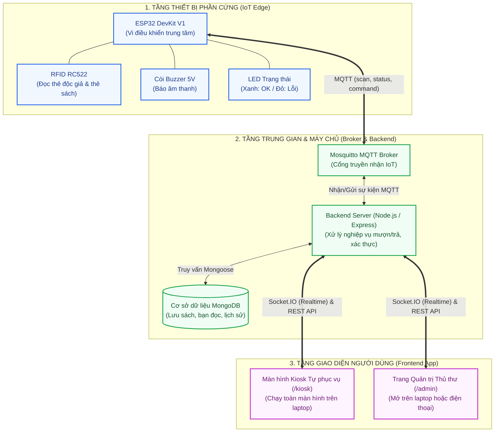

# 📚 Smart Library Kiosk - Hệ Thống Mượn / Trả Sách Tự Phục Vụ Thông Minh

> **Đề tài:** Nghiên cứu, thiết kế và triển khai hệ thống Kiosk mượn/trả sách tự phục vụ ứng dụng công nghệ IoT (Internet of Things) và RFID.

---

## 📖 1. Giới thiệu tổng quan

Hệ thống **Smart Library Kiosk** là giải pháp tự động hóa quy trình mượn và trả sách tại các thư viện trường học/công cộng. Hệ thống cho phép sinh viên, bạn đọc chủ động thực hiện toàn bộ giao dịch mượn - trả sách thông qua màn hình Kiosk cảm ứng và đầu đọc thẻ RFID mà không cần sự can thiệp thủ công của thủ thư.

### 🎯 Mục tiêu đề tài:
* **Tự động hóa & Tiết kiệm thời gian:** Giảm thiểu tình trạng xếp hàng chờ đợi tại quầy mượn sách giờ cao điểm.
* **Thời gian thực (Real-time IoT):** Mọi giao dịch mượn/trả sách được đồng bộ hóa tức thì giữa máy Kiosk vật lý và hệ thống quản trị của thủ thư thông qua giao thức **MQTT** và **WebSocket**.
* **Đơn giản hóa phần cứng & Tối ưu chi phí:** Triển khai mô hình Kiosk tinh gọn, độ tin cậy cao, chi phí phần cứng thấp (dưới 150.000 VNĐ).
* **Kiến trúc phần mềm chuẩn công nghiệp:** Tách biệt rõ ràng giữa Firmware (Edge), Broker (MQTT), Backend (Node.js/Express/MongoDB) và Frontend (React Kiosk & Admin).

---

## 🏛️ 2. Kiến trúc hệ thống (System Architecture)

Hệ thống được thiết kế theo mô hình 3 tầng (3-Tier IoT Architecture):



---

## ✨ 3. Tính năng chính của hệ thống

### 👤 Dành cho Bạn đọc (Giao diện Kiosk):
1. **Đăng nhập nhanh bằng thẻ sinh viên:** Quẹt thẻ RFID để xác thực danh tính và mở phiên làm việc.
2. **Mượn sách theo đợt (Batch Scanning):** Quẹt liên tục nhiều cuốn sách vào "Giỏ mượn" với còi chip phản hồi tức thì ("Bíp"), sau đó bấm xác nhận mượn tất cả chỉ trong 1 lần.
3. **Trả sách tự phục vụ:** Quẹt sách cần trả, hệ thống tự động kiểm tra hạn mượn và cập nhật kho sách.
4. **Xử lý quá hạn & Thanh toán VietQR:** Tự động tính tiền phạt nếu trễ hạn và sinh mã VietQR để người dùng quét nộp phạt qua ngân hàng.
5. **Tự động đăng xuất (Timeout):** Tự động trở về màn hình chờ sau 30-60 giây không có thao tác để bảo mật tài khoản.

### 👨‍💼 Dành cho Thủ thư (Giao diện Quản trị / Admin):
1. **Giám sát thiết bị theo thời gian thực (IoT Device Monitoring):**
   * Theo dõi trạng thái Kiosk **Online / Offline** (sử dụng cơ chế MQTT Last Will and Testament - LWT).
   * Giám sát cường độ tín hiệu WiFi (`RSSI`), thời gian hoạt động (`Uptime`), nhật ký quét thẻ.
   * Lệnh điều khiển từ xa: Kêu còi kiểm tra, khởi động lại Kiosk từ web.
2. **Quản lý danh mục sách & Độc giả (CRUD):** Thêm mới sách, gán mã RFID cho sách/độc giả, cập nhật thông tin.
3. **Báo cáo & Thống kê trực quan:** Biểu đồ số lượt mượn theo ngày/tuần, danh sách sách mượn nhiều nhất, danh sách nợ quá hạn.

### 🧪 Bộ giả lập thiết bị (Device Simulator):
* Hỗ trợ giả lập toàn bộ hành vi của ESP32 qua giao thức MQTT trên máy tính.
* Cho phép phát triển, kiểm thử toàn bộ hệ thống phần mềm (Web, Server, CSDL) mà **không cần kết nối phần cứng vật lý**.

---

## 🛠️ 4. Danh mục phần cứng & Dự toán kinh phí (BOM)

| STT | Tên linh kiện | Thông số / Chuẩn | Số lượng | Chi phí ước tính | Ghi chú |
| :---: | :--- | :--- | :---: | :---: | :--- |
| 1 | **ESP32 NodeMCU DevKit V1** | 30 chân, WiFi 2.4GHz + BLE | 1 | ~65.000 VNĐ | Cấp nguồn trực tiếp qua cáp USB laptop |
| 2 | **Module RFID RC522** | 13.56 MHz, giao tiếp SPI | 1 | ~28.000 VNĐ | Kèm sẵn 1 thẻ trắng Mifare 1K + 1 Keyfob |
| 3 | **Sticker / Miếng dán NFC RFID** | 13.56 MHz (NTAG213 / Mifare) | 3 - 5 | ~15.000 VNĐ | Dán vào bìa sách làm thẻ nhận diện |
| 4 | **Còi Buzzer chip 5V** | Còi chủ động (Active Buzzer) | 1 | ~3.000 VNĐ | Phản hồi âm thanh khi quét thẻ |
| 5 | **Đèn LED phi 5 + Điện trở 220Ω** | 1 Xanh lá (OK), 1 Đỏ (Error) | 2 bộ | ~2.000 VNĐ | Báo trạng thái thao tác |
| 6 | **Breadboard mini + Dây cắm** | Dây cắm Jumper Đực - Cái | 1 bộ | ~25.000 VNĐ | Đấu nối linh kiện không cần hàn |
| -- | **TỔNG KINH PHÍ PHẦN CỨNG** | | | **~138.000 VNĐ** | Siêu tiết kiệm cho sinh viên |

---

## 📂 5. Cấu trúc thư mục dự án

```text
library-kiosk/
├── README.md                     # Tài liệu hướng dẫn, kiến trúc và tổng quan dự án
├── package.json                  # Root npm workspace quản lý server, client, tools
├── docker-compose.yml            # Khởi chạy Mosquitto MQTT Broker & MongoDB
│
├── docs/
│   ├── architecture.md           # Thiết kế kiến trúc luồng dữ liệu chi tiết
│   ├── mqtt-topics.md            # Đặc tả Topic MQTT + JSON Payload hợp đồng
│   ├── api.md                    # Tài liệu REST API + Socket.IO Events
│   ├── database.md               # Sơ đồ CSDL MongoDB (Schemas)
│   └── wiring.md                 # Sơ đồ đấu nối chân ESP32 với RC522, LED, Buzzer
│
├── firmware/                     # Mã nguồn ESP32 (PlatformIO, C++ / Arduino Framework)
│   ├── platformio.ini            # Cấu hình board, thư viện MFRC522, PubSubClient
│   ├── include/
│   │   ├── config.example.h      # Cấu hình mẫu WiFi, MQTT Broker IP, Device ID
│   │   └── pins.h                # Định nghĩa chân SPI RC522, LED, Buzzer
│   └── src/
│       ├── main.cpp              # Khởi tạo máy trạng thái (FSM) và vòng lặp loop
│       ├── wifi_manager.cpp/.h   # Tự động kết nối và tái kết nối WiFi
│       ├── mqtt_client.cpp/.h    # Publish/Subscribe, Last Will, gửi Heartbeat
│       ├── rfid_reader.cpp/.h    # Đọc thẻ sinh viên & thẻ sách
│       └── indicators.cpp/.h     # Điều khiển còi Buzzer và đèn LED
│
├── server/                       # Backend REST API + MQTT Gateway (Node.js Express)
│   ├── package.json
│   ├── .env.example
│   └── src/
│       ├── index.js              # Điểm khởi chạy HTTP Server + Socket.IO + MQTT
│       ├── config/               # Kết nối Mongoose, biến môi trường
│       ├── models/               # Reader.js, Book.js, Loan.js, DeviceLog.js
│       ├── routes/               # API readers, books, loans, devices
│       ├── services/             # Nghiệp vụ mượn sách, trả sách, tính tiền phạt
│       ├── mqtt/
│       │   ├── client.js         # Kết nối Mosquitto Broker
│       │   ├── handlers/         # Xử lý sự kiện thẻ quét, cập nhật trạng thái Kiosk
│       │   └── publisher.js      # Gửi lệnh điều khiển còi/đèn xuống ESP32
│       └── sockets/              # Đẩy dữ liệu realtime lên giao diện React
│
├── client/                       # Frontend Web App (React + Vite + Tailwind/CSS)
│   ├── package.json
│   ├── vite.config.js
│   └── src/
│       ├── App.jsx               # Định tuyến Router: /kiosk và /admin
│       ├── socket/               # Lắng nghe sự kiện từ Backend qua Socket.IO
│       ├── pages/
│       │   ├── kiosk/            # Màn hình Idle, Giỏ mượn sách, Trả sách, VietQR
│       │   └── admin/            # Dashboard thống kê, Quản lý sách/độc giả, Kiosk status
│       └── components/           # Bảng dữ liệu, Modal, QR Code, Thẻ thông tin
│
└── tools/
    └── device-simulator/         # Tool giả lập ESP32 bằng Node.js khi chưa có mạch
        ├── package.json
        └── simulate.js           # Giả lập quét thẻ, gửi heartbeat, nhận lệnh điều khiển
```

---

## 📡 6. Đặc tả hợp đồng giao tiếp MQTT (MQTT Contract)

| Hướng | Topic | Payload mẫu | Ý nghĩa |
| :--- | :--- | :--- | :--- |
| **ESP32 ➔ Server** | `kiosk/{deviceId}/scan` | `{"uid": "E2801192", "type": "rfid"}` | Gửi UID thẻ vừa quẹt |
| **ESP32 ➔ Server** | `kiosk/{deviceId}/status` | `{"status": "online", "rssi": -62, "uptime": 3600}` | Báo cáo nhịp tim (Heartbeat 30s/lần) |
| **ESP32 ➔ Server** | `kiosk/{deviceId}/status` *(LWT)* | `{"status": "offline"}` | Tự động bắn khi mất kết nối đột ngột |
| **Server ➔ ESP32** | `kiosk/{deviceId}/command` | `{"action": "feedback", "status": "success"}` | Ra lệnh kêu "bíp" + nháy LED xanh |
| **Server ➔ ESP32** | `kiosk/{deviceId}/command` | `{"action": "feedback", "status": "error"}` | Ra lệnh kêu "bíp bíp" + nháy LED đỏ |
| **Server ➔ ESP32** | `kiosk/{deviceId}/command` | `{"action": "reboot"}` | Khởi động lại ESP32 từ xa |

---

## 🚀 7. Hướng dẫn cài đặt & Chạy thử nhanh (Quick Start)

### Yêu cầu môi trường:
* **Node.js:** v18 trở lên
* **Docker & Docker Compose** (hoặc cài trực tiếp MongoDB và Mosquitto trên máy tính)
* **PlatformIO IDE** (Cài extension trên VS Code để nạp code ESP32)

### Các bước chạy hệ thống:

1. **Khởi chạy Hạ tầng (Mosquitto MQTT & MongoDB):**
   ```bash
   docker-compose up -d
   ```

2. **Cài đặt & Chạy Backend Server:**
   ```bash
   cd server
   npm install
   cp .env.example .env
   npm run seed      # Nạp dữ liệu độc giả và sách mẫu
   npm run dev       # Chạy server tại http://localhost:5000
   ```

3. **Cài đặt & Chạy Giao diện Kiosk / Admin:**
   ```bash
   cd ../client
   npm install
   npm run dev       # Truy cập Kiosk tại http://localhost:5173/kiosk
                     # Truy cập Admin tại http://localhost:5173/admin
   ```

4. **Chạy Giả lập Thiết bị IoT Phần cứng (Chạy song song với Kiosk UI):**
   * Mở một cửa sổ Terminal riêng biệt:
   ```bash
   npm run sim    # Hoặc: node tools/device-simulator/simulate.js
   ```
   * Bảng điều khiển giả lập phần cứng ESP32 sẽ hiện lên với đầy đủ phản hồi cơ cấu chấp hành (LED xanh/đỏ, còi Buzzer, màn hình LCD 16x2) và danh mục phím quẹt thẻ:
     - `[1]`: Quẹt **Thẻ Bạn Đọc PTIT** (`E2801192` - Nguyễn Văn A) ➔ Kiosk đăng nhập & tải dữ liệu mượn.
     - `[2]`: Quẹt **Sách QUÁ HẠN 3 NGÀY** (`A1B2C3D4`) ➔ Test TRẢ SÁCH QUÁ HẠN: Kiosk tự động tính phí phạt 15.000đ, bật mã VietQR thanh toán & gửi email biên lai!
     - `[3]`: Quẹt **Sách ĐANG MƯỢN ĐÚNG HẠN** (`D4C3B2A1`) ➔ Test GIA HẠN THÊM 14 NGÀY hoặc TRẢ SÁCH ĐÚNG HẠN (Phí 0đ).
     - `[4]`, `[5]`, `[6]`: Quẹt **Sách CÓ SẴN KHO** (`B3C4D5E6`, `C5D6E7F8`, `E9F0A1B2`) ➔ Test MƯỢN MỚI TÀI LIỆU theo giỏ hàng.
     - `[7]`: Quẹt **Thẻ Sinh Viên 2** (`A8B9C0D1` - Trần Thị Mai).
     - `[8]`: Quẹt **Thẻ Lạ / Chưa đăng ký** (`99999999`) ➔ Kiosk từ chối, thiết bị kêu 3 tiếng bíp và nháy LED đỏ.
     - `[c]`: Quẹt thủ công bằng cách nhập mã UID bất kỳ.
     - `[h]`: Gửi gói tin nhịp tim (Ping Online).

5. **Nạp code cho ESP32 (Khi có phần cứng):**
   * Mở thư mục `firmware/` bằng VS Code (đã cài PlatformIO).
   * Tạo file `include/config.h` từ `include/config.example.h` và điền tên WiFi, mật khẩu và IP máy tính chạy MQTT Broker.
   * Cắm cáp USB nối ESP32 với máy tính và bấm **Upload**.

---

## 🔮 8. Định hướng phát triển mở rộng (Future Works)

* **Nâng cấp RFID UHF (860–960MHz):** Thay thế đầu đọc RC522 bằng module UHF để hỗ trợ đặt nguyên chồng 5–10 cuốn sách quét đồng thời (Bulk Reading).
* **Tích hợp Cổng từ an ninh (EAS Gate):** Kết nối tín hiệu với cổng kiểm soát tại lối ra vào thư viện nhằm phát hiện sách chưa hoàn tất thủ tục mượn.
* **Xác thực khuôn mặt (Face Recognition):** Nhận diện khuôn mặt sinh viên qua camera Kiosk để tăng cường bảo mật.