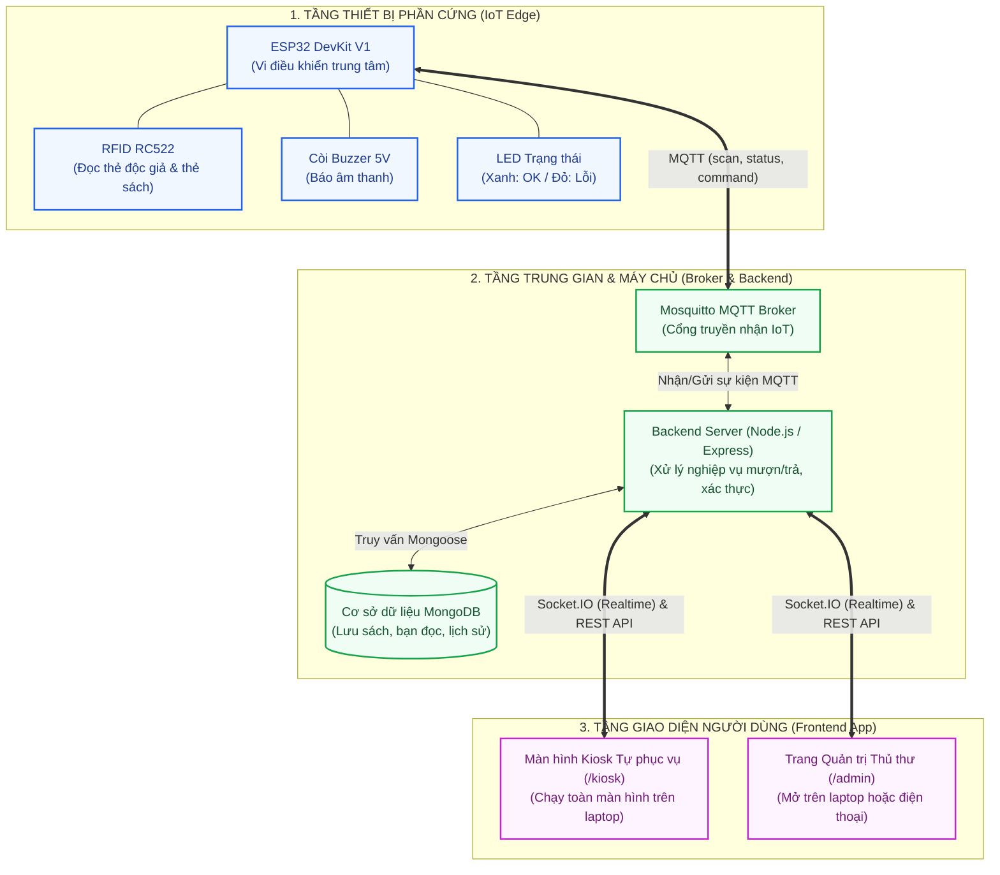

# 📚 Smart Library Kiosk - Hệ Thống Mượn / Trả Sách Tự Phục Vụ Thông Minh

[](https://github.com/DaoDuyHai/btl_iot/actions/workflows/ci.yml)
[]()
[]()
[]()

> **Đề tài:** Nghiên cứu, thiết kế và triển khai hệ thống Kiosk mượn/trả sách tự phục vụ ứng dụng công nghệ IoT (Internet of Things), RFID và Trợ lý Thủ thư AI (Multilingual-E5 + BM25 + Intent/Emotion Routing).

### 🖥️ Môi trường Truy cập Cục bộ (Localhost):
* 🖥️ **Màn hình Kiosk Tự phục vụ:** [http://localhost:5173/kiosk](http://localhost:5173/kiosk)
* 🛡️ **Cổng Quản trị Thủ thư (Admin):** [http://localhost:5173/admin](http://localhost:5173/admin)
* ⚙️ **Hạ tầng Backend API (Express):** [http://localhost:5000/api/health](http://localhost:5000/api/health)
* 🤖 **Trợ lý AI Tìm kiếm Sách (FastAPI):** [http://localhost:8000/docs](http://localhost:8000/docs)
* 💳 **Bảng Điều Khiển Quẹt Thẻ Giả lập:** [http://localhost:8888](http://localhost:8888)

---

## 📖 1. Giới thiệu tổng quan

Hệ thống **Smart Library Kiosk** là giải pháp tự động hóa quy trình mượn và trả sách tại các thư viện trường học/công cộng. Hệ thống cho phép sinh viên, bạn đọc chủ động thực hiện toàn bộ giao dịch mượn - trả sách thông qua màn hình Kiosk cảm ứng và đầu đọc thẻ RFID mà không cần sự can thiệp thủ công của thủ thư.

### 🎯 Mục tiêu đề tài:
* **Tự động hóa & Tiết kiệm thời gian:** Giảm thiểu tình trạng xếp hàng chờ đợi tại quầy mượn sách giờ cao điểm.
* **Thời gian thực (Real-time IoT):** Mọi giao dịch mượn/trả sách được đồng bộ hóa tức thì giữa máy Kiosk vật lý và hệ thống quản trị của thủ thư thông qua giao thức **MQTT** và **WebSocket**.
* **Đơn giản hóa phần cứng & Tối ưu chi phí:** Triển khai mô hình Kiosk tinh gọn, độ tin cậy cao, chi phí phần cứng thấp (dưới 150.000 VNĐ).
* **Kiến trúc phần mềm chuẩn công nghiệp:** Tách biệt rõ ràng giữa Firmware (Edge), Broker (MQTT), Backend (Node.js/Express/MongoDB) và Frontend (React Kiosk & Admin).

---

## 🏛️ 2. Kiến trúc hệ thống (System Architecture - IoT Level 3)

> 📌 **Phân loại Kiến trúc IoT:** Hệ thống được thiết kế và triển khai chuẩn mực theo mô hình **IoT Level 3** (theo tiêu chuẩn phân loại quốc tế của *Arshdeep Bahga & Vijay Madisetti*): Nút biên ESP32 chỉ đảm nhiệm việc thu thập dữ liệu thẻ RFID và phản hồi còi/LED; toàn bộ dữ liệu, thuật toán phân tích nghiệp vụ và ứng dụng giao diện được vận hành tập trung $100\%$ trên nền tảng Đám mây (Cloud-based Application & Analytics).

Hệ thống được thiết kế theo mô hình 3 tầng (3-Tier IoT Architecture):



---

## ✨ 3. Tính năng chính của hệ thống

### 👤 Dành cho Bạn đọc (Giao diện Kiosk):
1. **Đăng nhập nhanh bằng thẻ sinh viên:** Quẹt thẻ RFID để xác thực danh tính và mở phiên làm việc.
2. **Mượn sách theo đợt (Batch Scanning):** Quẹt liên tục nhiều cuốn sách vào "Giỏ mượn" với còi chip phản hồi tức thì ("Bíp"), sau đó bấm xác nhận mượn tất cả chỉ trong 1 lần.
3. **Trả sách tự phục vụ:** Quẹt sách cần trả, hệ thống tự động kiểm tra hạn mượn và cập nhật kho sách.
4. **Xử lý quá hạn & Thanh toán VietQR:** Tự động tính tiền phạt nếu trễ hạn và sinh mã VietQR để người dùng quét nộp phạt qua ngân hàng.
5. **Tự động đăng xuất (Timeout):** Tự động trở về màn hình chờ sau 30-60 giây không có thao tác để bảo mật tài khoản.

### 👨‍💼 Dành cho Thủ thư (Giao diện Quản trị / Admin):
1. **Giám sát thiết bị theo thời gian thực (IoT Device Monitoring):**
   * Theo dõi trạng thái Kiosk **Online / Offline** (sử dụng cơ chế MQTT Last Will and Testament - LWT).
   * Giám sát cường độ tín hiệu WiFi (`RSSI`), thời gian hoạt động (`Uptime`), nhật ký quét thẻ.
   * Lệnh điều khiển từ xa: Kêu còi kiểm tra, khởi động lại Kiosk từ web.
2. **Quản lý danh mục sách & Độc giả (CRUD):** Thêm mới sách, gán mã RFID cho sách/độc giả, cập nhật thông tin.
3. **Báo cáo & Thống kê trực quan:** Biểu đồ số lượt mượn theo ngày/tuần, danh sách sách mượn nhiều nhất, danh sách nợ quá hạn.

### 🧪 Bộ giả lập thiết bị (Device Simulator):
* Hỗ trợ giả lập toàn bộ hành vi của ESP32 qua giao thức MQTT trên máy tính.
* Cho phép phát triển, kiểm thử toàn bộ hệ thống phần mềm (Web, Server, CSDL) mà **không cần kết nối phần cứng vật lý**.

---

## 🛠️ 4. Danh mục phần cứng & Dự toán kinh phí (BOM)

| STT | Tên linh kiện | Thông số / Chuẩn | Số lượng | Chi phí ước tính | Ghi chú |
| :---: | :--- | :--- | :---: | :---: | :--- |
| 1 | **ESP32 NodeMCU DevKit V1** | 30 chân, WiFi 2.4GHz + BLE | 1 | ~65.000 VNĐ | Cấp nguồn trực tiếp qua cáp USB laptop |
| 2 | **Module RFID RC522** | 13.56 MHz, giao tiếp SPI | 1 | ~28.000 VNĐ | Kèm sẵn 1 thẻ trắng Mifare 1K + 1 Keyfob |
| 3 | **Sticker / Miếng dán NFC RFID** | 13.56 MHz (NTAG213 / Mifare) | 3 - 5 | ~15.000 VNĐ | Dán vào bìa sách làm thẻ nhận diện |
| 4 | **Còi Buzzer chip 5V** | Còi chủ động (Active Buzzer) | 1 | ~3.000 VNĐ | Phản hồi âm thanh khi quét thẻ |
| 5 | **Đèn LED phi 5 + Điện trở 220Ω** | 1 Xanh lá (OK), 1 Đỏ (Error) | 2 bộ | ~2.000 VNĐ | Báo trạng thái thao tác |
| 6 | **Breadboard mini + Dây cắm** | Dây cắm Jumper Đực - Cái | 1 bộ | ~25.000 VNĐ | Đấu nối linh kiện không cần hàn |
| -- | **TỔNG KINH PHÍ PHẦN CỨNG** | | | **~138.000 VNĐ** | Siêu tiết kiệm cho sinh viên |

---

## 📂 5. Cấu trúc thư mục dự án

```text
library-kiosk/
├── .github/
│   └── workflows/
│       └── ci-cd.yml             # GitHub Actions CI/CD Pipeline (Lint, Test, Docker Build, CD Fly.io)
├── .husky/                       # Git Pre-commit Hooks (Tự động chặn commit lỗi cú pháp)
├── eslint.config.js              # Cấu hình linter chuẩn Flat Config (ESLint 9 + React + JSX)
├── .prettierrc                   # Định dạng mã nguồn chuẩn mực toàn dự án
├── docker-compose.yml            # Khởi chạy toàn bộ hạ tầng: Mosquitto, Backend, Frontend Nginx
├── package.json                  # Root workspace quản lý scripts kiểm thử, linting và tools
├── README.md                     # Tài liệu hướng dẫn, kiến trúc và tổng quan dự án
│
├── docs/
│   ├── architecture.md           # Thiết kế kiến trúc luồng dữ liệu chi tiết
│   ├── mqtt-topics.md            # Đặc tả Topic MQTT + JSON Payload hợp đồng
│   ├── api.md                    # Tài liệu REST API + Socket.IO Events
│   ├── database.md               # Sơ đồ CSDL MongoDB (Schemas)
│   └── wiring.md                 # Sơ đồ đấu nối chân ESP32 với RC522, LED, Buzzer
│
├── firmware/                     # Mã nguồn ESP32 (PlatformIO, C++ / Arduino Framework)
│   ├── platformio.ini            # Cấu hình board, thư viện MFRC522, PubSubClient
│   ├── include/
│   │   ├── config.example.h      # Cấu hình mẫu WiFi, MQTT Broker IP, Device ID
│   │   └── pins.h                # Định nghĩa chân SPI RC522, LED, Buzzer
│   └── src/
│       ├── main.cpp              # Khởi tạo máy trạng thái (FSM) và vòng lặp loop
│       ├── wifi_manager.cpp/.h   # Tự động kết nối và tái kết nối WiFi
│       ├── mqtt_client.cpp/.h    # Publish/Subscribe, Last Will, gửi Heartbeat
│       ├── rfid_reader.cpp/.h    # Đọc thẻ sinh viên & thẻ sách
│       └── indicators.cpp/.h     # Điều khiển còi Buzzer và đèn LED
│
├── server/                       # Backend REST API + MQTT Gateway (Node.js Express)
│   ├── fly.toml                  # Cấu hình triển khai đám mây Micro-VM Fly.io Singapore
│   ├── Dockerfile                # Docker image Node.js 20 Alpine siêu nhẹ
│   ├── vitest.config.js          # Cấu hình Vitest + v8 Code Coverage
│   ├── package.json
│   ├── .env.example
│   ├── tests/                    # Bộ kiểm thử tự động toàn diện (21/21 Tests Passed)
│   │   ├── unit/                 # Unit test env Zod, logic tính phạt, VietQR, giới hạn mượn
│   │   └── integration/          # Supertest API, Race condition mượn trùng, Realtime Socket.IO
│   └── src/
│       ├── index.js              # Điểm khởi chạy HTTP Server + Socket.IO + MQTT (0.0.0.0)
│       ├── config/               # Schema xác thực biến môi trường Zod, Mongoose DB
│       ├── models/               # Reader.js, Book.js, Loan.js, DeviceLog.js
│       ├── routes/               # API readers, books, loans, devices
│       ├── services/             # Nghiệp vụ mượn sách, trả sách, tính tiền phạt
│       ├── mqtt/
│       │   ├── client.js         # Kết nối Mosquitto Broker
│       │   ├── handlers/         # Xử lý sự kiện thẻ quét, cập nhật trạng thái Kiosk
│       │   └── publisher.js      # Gửi lệnh điều khiển còi/đèn xuống ESP32
│       └── sockets/              # Đẩy dữ liệu realtime lên giao diện React
│
├── client/                       # Frontend Web App (React + Vite + Tailwind/CSS)
│   ├── vercel.json               # Cấu hình điều hướng Single Page Application (SPA) trên Vercel
│   ├── Dockerfile                # Multi-stage Docker build nén tĩnh sang máy chủ Web Nginx Alpine
│   ├── nginx.conf                # Cấu hình Reverse Proxy & SPA Routing cho Docker
│   ├── package.json
│   ├── vite.config.js
│   └── src/
│       ├── App.jsx               # Định tuyến Router: /kiosk và /admin
│       ├── socket/               # Lắng nghe sự kiện từ Backend qua Socket.IO
│       ├── pages/
│       │   ├── kiosk/            # Màn hình Idle, Giỏ mượn sách, Trả sách, VietQR
│       │   └── admin/            # Dashboard thống kê, Quản lý sách/độc giả, Kiosk status
│       └── components/           # Bảng dữ liệu, Modal, QR Code, Thẻ thông tin
│
└── tools/
    └── device-simulator/         # Tool giả lập ESP32 bằng Node.js khi chưa có mạch
        ├── package.json
        └── simulate.js           # Giả lập quét thẻ, gửi heartbeat, nhận lệnh điều khiển
```

---

## 📡 6. Đặc tả hợp đồng giao tiếp MQTT (MQTT Contract)

| Hướng | Topic | Payload mẫu | Ý nghĩa |
| :--- | :--- | :--- | :--- |
| **ESP32 ➔ Server** | `kiosk/{deviceId}/scan` | `{"uid": "E2801192", "type": "rfid"}` | Gửi UID thẻ vừa quẹt |
| **ESP32 ➔ Server** | `kiosk/{deviceId}/status` | `{"status": "online", "rssi": -62, "uptime": 3600}` | Báo cáo nhịp tim (Heartbeat 30s/lần) |
| **ESP32 ➔ Server** | `kiosk/{deviceId}/status` *(LWT)* | `{"status": "offline"}` | Tự động bắn khi mất kết nối đột ngột |
| **Server ➔ ESP32** | `kiosk/{deviceId}/command` | `{"action": "feedback", "status": "success"}` | Ra lệnh kêu "bíp" + nháy LED xanh |
| **Server ➔ ESP32** | `kiosk/{deviceId}/command` | `{"action": "feedback", "status": "error"}` | Ra lệnh kêu "bíp bíp" + nháy LED đỏ |
| **Server ➔ ESP32** | `kiosk/{deviceId}/command` | `{"action": "reboot"}` | Khởi động lại ESP32 từ xa |

---

## 🚀 7. Hướng dẫn cài đặt & Chạy thử nhanh (Quick Start)

### Yêu cầu môi trường:
* **Node.js:** v18 hoặc v20+ trở lên.
* **Python:** 3.10+ (nếu chạy AI Search Service cục bộ).
* **Docker & Docker Compose** (khuyên dùng để tự động chạy Mosquitto & MongoDB trong 1 lệnh) HOẶC cài trực tiếp MongoDB và Mosquitto trên máy tính.

---

### Cách 1: Khởi chạy Tự động 1-Click (Khuyên dùng trên Windows)

Chỉ cần double-click file **`start.bat`** tại thư mục gốc của dự án:
- File script sẽ **tự động kiểm tra và sao chép cấu hình `.env`** từ `.env.example` (nếu chưa có).
- **Tự động cài đặt dependencies (`node_modules`)** cho Server, Client và IoT Simulator (nếu chưa cài).
- **Tự động khởi động MQTT Mosquitto Broker và MongoDB** qua Docker (nếu máy có Docker).
- **Tự động mở 4 cửa sổ riêng biệt** cho AI Service, Backend Express, Frontend React Vite và IoT Simulator.

> 💡 **Lưu ý lần đầu chạy:** Mở một cửa sổ Terminal tại thư mục gốc và chạy lệnh nạp dữ liệu sách & thẻ bạn đọc mẫu vào database:
> ```bash
> npm run seed
> ```

---

### Cách 2: Khởi chạy Thủ công từng bước bằng Terminal

1. **Cài đặt thư viện toàn dự án & tạo file môi trường (.env):**
   ```bash
   npm run setup
   ```

2. **Khởi chạy Hạ tầng (Mosquitto MQTT & MongoDB qua Docker):**
   ```bash
   docker-compose up -d
   ```
   *(Nếu không dùng Docker, bạn hãy đảm bảo dịch vụ MongoDB và Mosquitto MQTT đã được bật trên máy).*

3. **Nạp dữ liệu mẫu vào cơ sở dữ liệu:**
   ```bash
   npm run seed
   ```

4. **Khởi chạy đồng thời toàn bộ hệ thống:**
   ```bash
   npm start        # Khởi chạy toàn bộ qua start.bat
   ```
   *Hoặc mở các Terminal riêng lẻ:*
   ```bash
   npm run server:dev    # Backend Server (Port 5000)
   npm run client:dev    # Frontend Web App (Port 5173)
   npm run ai:dev        # AI Search Service (Port 8000)
   npm run sim:local     # Giả lập phần cứng IoT (Web GUI: http://localhost:8888)
   ```

4. **Chạy Giả lập Thiết bị IoT Phần cứng (Chạy song song với Kiosk UI):**
   * Mở một cửa sổ Terminal riêng biệt:
   ```bash
   npm run sim    # Hoặc: node tools/device-simulator/simulate.js
   ```
   * Bảng điều khiển giả lập phần cứng ESP32 sẽ hiện lên với đầy đủ phản hồi cơ cấu chấp hành (LED xanh/đỏ, còi Buzzer, màn hình LCD 16x2) và danh mục phím quẹt thẻ:
     - `[1]`: Quẹt **Thẻ Bạn Đọc PTIT** (`E2801192` - Nguyễn Văn A) ➔ Kiosk đăng nhập & tải dữ liệu mượn.
     - `[2]`: Quẹt **Sách QUÁ HẠN 3 NGÀY** (`A1B2C3D4`) ➔ Test TRẢ SÁCH QUÁ HẠN: Kiosk tự động tính phí phạt 15.000đ, bật mã VietQR thanh toán & gửi email biên lai!
     - `[3]`: Quẹt **Sách ĐANG MƯỢN ĐÚNG HẠN** (`D4C3B2A1`) ➔ Test GIA HẠN THÊM 14 NGÀY hoặc TRẢ SÁCH ĐÚNG HẠN (Phí 0đ).
     - `[4]`, `[5]`, `[6]`: Quẹt **Sách CÓ SẴN KHO** (`B3C4D5E6`, `C5D6E7F8`, `E9F0A1B2`) ➔ Test MƯỢN MỚI TÀI LIỆU theo giỏ hàng.
     - `[7]`: Quẹt **Thẻ Sinh Viên 2** (`A8B9C0D1` - Trần Thị Mai).
     - `[8]`: Quẹt **Thẻ Lạ / Chưa đăng ký** (`99999999`) ➔ Kiosk từ chối, thiết bị kêu 3 tiếng bíp và nháy LED đỏ.
     - `[c]`: Quẹt thủ công bằng cách nhập mã UID bất kỳ.
     - `[h]`: Gửi gói tin nhịp tim (Ping Online).

5. **Nạp code cho ESP32 (Khi có phần cứng):**
   * Mở thư mục `firmware/` bằng VS Code (đã cài PlatformIO).
   * Tạo file `include/config.h` từ `include/config.example.h` và điền tên WiFi, mật khẩu và IP máy tính chạy MQTT Broker.
   * Cắm cáp USB nối ESP32 với máy tính và bấm **Upload**.

---

## 🛡️ 8. Đảm bảo chất lượng & Tự động hóa CI/CD (Quality Assurance & DevOps)

Dự án được xây dựng theo chuẩn mực kỹ thuật công nghiệp khắt khe, tích hợp đầy đủ công cụ phân tích tĩnh, bộ kiểm thử tự động đa tầng và đường ống CI/CD tự động:

### a) Kiểm thử tự động với Vitest (12 Test Suites - 68/68 Tests Passed)
Hệ thống tích hợp bộ kiểm thử toàn diện với thời gian thực thi siêu tốc ($\approx 2.4\text{s}$), chạy độc lập không phụ thuộc kết nối mạng:
* **Unit Tests (`server/tests/unit/`):**
  - **Zod Environment Validation (`env.test.js`):** Thẩm định các biến cấu hình trọng yếu, chặn khởi động nếu thiếu.
  - **Nghiệp vụ Mượn/Trả (`loanService.test.js` - 20 tests):** Thẩm định công thức phạt trễ hạn ($5.000\text{đ/ngày}$), sinh link VietQR chuẩn Napas, kiểm tra hạn mức mượn tối đa 5 cuốn, gộp biên lai thanh toán, kiểm tra sách hỏng.
  - **Tầng IoT MQTT (`mqttHandler.test.js` - 6 tests):** Xử lý quẹt thẻ RFID từ phần cứng, thuật toán chống rung (`debounce cooldown`), chặn thẻ khóa, nhận diện thẻ sách, nhịp tim thiết bị.
  - **AI Gateway (`aiController.test.js` - 7 tests):** Điều phối tìm kiếm, gợi ý theo khoa, cơ chế tự động Fallback sang Catalog Precision in-memory khi AI Service offline.
  - **Precision Catalog Service (`catalogService.test.js` - 4 tests):** Nạp 3,000 sách vào RAM, nhận diện Intent ngôn ngữ (Anh/Nhật/Trung), chuẩn hóa tiếng Việt không dấu.
  - **Gửi Email Biên lai (`emailService.test.js` - 3 tests):** Gửi email biên lai mượn/trả điện tử tự động tới bạn đọc PTIT.
  - **Quản lý Bạn đọc & Thiết bị (`readerController.test.js`, `deviceController.test.js`, `bookController.test.js`):** CRUD bạn đọc, lệnh điều khiển buzzer/LED phần cứng, reboot kiosk.
* **Integration Tests (`server/tests/integration/`):**
  - **REST API Endpoints với Supertest (`api.test.js` - 9 tests):** Kiểm thử toàn diện `/api/health`, `/api/books`, xử lý từ chối dữ liệu rỗng `/api/loans/borrow` (400 Bad Request), gửi lệnh còi/đèn `/api/devices/:deviceId/command`.
  - **Bảo vệ xung đột đồng thời (Race Condition Testing - `raceCondition.test.js`):** Giả lập `Promise.all` 2 yêu cầu mượn đồng thời cùng 1 cuốn sách để kiểm tra cơ chế Atomic Lock, chống chiếm quyền phiên.
  - **Kiểm thử WebSocket Realtime (`socket.test.js`):** Khởi tạo máy chủ HTTP tạm và kết nối với client thực bằng `socket.io-client` để thẩm định sự kiện `kiosk:event`.

```bash
npm test            # Chạy toàn bộ 68 test case
npm run test:coverage # Xuất báo cáo độ bao phủ mã nguồn (Coverage Report)
npm run lint        # Quét lỗi cú pháp toàn repo (ESLint 9 - 0 warnings)
```

### b) Đường ống Tự động hóa CI (GitHub Actions)
Mỗi lần nhà phát triển đẩy mã (`git push origin main`):
1. **GitHub Runner (Ubuntu)** tự động kích hoạt workflow `.github/workflows/ci.yml`.
2. Kiểm tra cú pháp toàn diện (`npm run lint`).
3. Thực thi trọn vẹn 68 test case (`npm test`) kèm báo cáo coverage.
4. Đóng gói mã nguồn Frontend Vite & Kiểm tra build Docker Images.

---

## 🔮 9. Định hướng phát triển mở rộng (Future Works)

* **Nâng cấp RFID UHF (860–960MHz):** Thay thế đầu đọc RC522 bằng module UHF để hỗ trợ đặt nguyên chồng 5–10 cuốn sách quét đồng thời (Bulk Reading).
* **Tích hợp Cổng từ an ninh (EAS Gate):** Kết nối tín hiệu với cổng kiểm soát tại lối ra vào thư viện nhằm phát hiện sách chưa hoàn tất thủ tục mượn.
* **Xác thực khuôn mặt (Face Recognition):** Nhận diện khuôn mặt sinh viên qua camera Kiosk để tăng cường bảo mật.