# HỌC VIỆN CÔNG NGHỆ BƯU CHÍNH VIỄN THÔNG

## KHOA CÔNG NGHỆ THÔNG TIN I

---

# BÁO CÁO KỸ THUẬT ĐỀ TÀI BÀI TẬP LỚN

### HỌC PHẦN: INTERNET OF THINGS (IoT) VÀ ỨNG DỤNG

---

# ĐỀ TÀI:

## THIẾT KẾ VÀ TRIỂN KHAI HỆ THỐNG KIOSK THƯ VIỆN TỰ PHỤC VỤ THÔNG MINH DỰA TRÊN CÔNG NGHỆ NHẬN DẠNG SÓNG VÔ TUYẾN RFID VÀ KIẾN TRÚC PHÂN TÁN IoT

---

**Cán bộ hướng dẫn khoa học:** Giảng viên Bộ môn Mạng & Hệ thống thông tin  
**Đơn vị đào tạo:** Khoa Công nghệ Thông tin 1 – Học viện Công nghệ Bưu chính Viễn thông  
**Chuyên ngành:** Công nghệ Thông tin / Kỹ thuật Mạng & IoT  
**Hệ đào tạo:** Đại học chính quy khóa 2021 – 2026  
**Địa điểm & Thời gian thực hiện:** Hà Nội, Học kỳ I – Năm học 2025–2026

---

## LỜI CAM ĐOAN

Chúng em xin cam đoan rằng toàn bộ nội dung công trình nghiên cứu và báo cáo kỹ thuật với đề tài **"Thiết kế và triển khai Hệ thống Kiosk Thư viện Tự phục vụ Thông minh dựa trên công nghệ nhận dạng sóng vô tuyến RFID và kiến trúc phân tán IoT"** là kết quả làm việc nghiêm túc, độc lập và trung thực của tập thể nhóm dưới sự định hướng học thuật của giảng viên hướng dẫn.

Các số liệu thực nghiệm, lược đồ kiến trúc, lưu đồ giải thuật, mô hình cơ sở dữ liệu và toàn bộ mã nguồn phần mềm (bao gồm Firmware nhúng trên vi điều khiển ESP32, dịch vụ trung gian Gateway Node.js, giao thức truyền thông MQTT/WebSocket và giao diện Kiosk cảm ứng React) được chúng em tự nghiên cứu, thiết kế và phát triển. Các tài liệu trích dẫn, công trình khoa học và thư viện mã nguồn mở kế thừa đều được ghi chú xuất xứ và liệt kê rõ ràng trong phần Danh mục Tài liệu tham khảo theo đúng chuẩn mực học thuật quốc tế.

_Hà Nội, ngày 02 tháng 11 năm 2026_  
**Đại diện nhóm sinh viên thực hiện**

---

## LỜI CẢM ƠN

Để hoàn thành công trình nghiên cứu khoa học và báo cáo bài tập lớn này, nhóm chúng em đã nhận được sự quan tâm, giảng dạy và hỗ trợ vô cùng to lớn từ các cấp lãnh đạo, các thầy cô giáo và nhà trường.

Trước hết, nhóm xin bày tỏ lòng biết ơn chân thành và sâu sắc nhất tới toàn thể các Thầy/Cô giáo thuộc **Khoa Công nghệ Thông tin 1 – Học viện Công nghệ Bưu chính Viễn thông**, đặc biệt là các Thầy/Cô phụ trách bộ môn **Internet of Things (IoT) và ứng dụng**. Những bài giảng lý thuyết sâu sắc về kiến trúc IoT phân lớp, mô hình truyền thông nhẹ hướng sự kiện, cơ chế quản lý tài nguyên vi điều khiển thời gian thực và phương pháp luận thiết kế hệ thống nhúng đã trở thành kim chỉ nam vững chắc giúp chúng em định hình tư duy kỹ thuật trong suốt quá trình triển khai dự án.

Nhóm cũng xin chân thành cảm ơn Ban Giám đốc và các cán bộ phụ trách Trung tâm Thông tin Thư viện Học viện Công nghệ Bưu chính Viễn thông đã tạo điều kiện khảo sát thực tế, chia sẻ những thông tin quý báu về quy trình quản trị tài liệu theo chuẩn Koha, phân tích những bất cập trong việc mượn - trả thủ công vào các đợt cao điểm, qua đó giúp đề tài bám sát nhu cầu thực tiễn và giải quyết trọn vẹn bài toán vận hành của nhà trường.

Mặc dù nhóm đã nỗ lực vận dụng tối đa các chuẩn mực kỹ thuật công nghiệp hiện đại, song với giới hạn về thời gian và kinh nghiệm nghiên cứu, bài báo cáo khó tránh khỏi những thiếu sót nhất định. Nhóm chúng em rất mong nhận được những nhận xét, phê bình và định hướng học thuật quý báu từ quý Thầy/Cô để dự án ngày càng hoàn thiện, sẵn sàng cho việc nhân rộng mô hình trong thực tế.

_Trân trọng cảm ơn!_

---

## TÓM TẮT BÁO CÁO (ABSTRACT)

Báo cáo trình bày toàn diện quá trình nghiên cứu, thiết kế phần cứng, xây dựng giải pháp truyền thông mạng và triển khai nền tảng phần mềm cho **Hệ thống Kiosk Thư viện Tự phục vụ Thông minh (Smart Library Self-Service Kiosk)**. Hệ thống là sự kết hợp chặt chẽ giữa công nghệ nhận dạng tần số vô tuyến **RFID High Frequency 13.56 MHz (ISO/IEC 14443A)**, vi điều khiển tích hợp Wi-Fi **ESP32 Dual-Core**, giao thức truyền tin đo xa siêu nhẹ **MQTT** kết hợp cơ chế kiểm soát nhịp tim (Heartbeat) / Di chúc kết nối (Last Will and Testament), giao thức truyền thông song công thời gian thực **WebSocket (Socket.IO)** và hệ sinh thái máy chủ ứng dụng **Node.js/Express/MongoDB**.

Hệ thống giải quyết triệt để 3 bài toán nhức nhối trong quản trị thư viện trường đại học truyền thống:

1. **Tự động hóa toàn diện quy trình:** Loại bỏ khâu ghi chép thủ công, cho phép sinh viên tự quẹt thẻ nhận diện danh tính và thực hiện mượn sách theo đợt (Batch Borrowing) với độ trễ phản hồi dưới $250\text{ ms}$.
2. **Kiểm soát tính toàn vẹn và chống thất thoát:** Tự động đối soát thời hạn mượn, tính toán chính xác tiền phạt trễ hạn theo ngày ($5.000\text{ VNĐ/ngày}$), khóa cưỡng chế nút hoàn thành trả sách và sinh mã thanh toán trực tuyến tức thì theo chuẩn **VietQR Napas247**.
3. **Trải nghiệm người dùng cao cấp & Bảo mật phiên:** Ứng dụng giao diện Kiosk cảm ứng chuyên dụng mang bản sắc nhận diện Đỏ Đô Học viện (PTIT Crimson Theme), tích hợp thuật toán chống chiếm quyền phiên làm việc (Anti-Session Hijacking) và cơ chế tự động gộp một biên lai điện tử duy nhất gửi về hòm thư Gmail của sinh viên thông qua dịch vụ SMTP.

Hệ thống được thiết kế và hiện thực hóa chuẩn mực theo kiến trúc **IoT Level 3** (theo tiêu chuẩn phân loại kinh điển của Arshdeep Bahga và Vijay Madisetti): nút thiết bị biên tinh gọn thực hiện thu thập dữ liệu thẻ và phản hồi tín hiệu, toàn bộ cơ sở dữ liệu và thuật toán phân tích nghiệp vụ được xử lý tập trung trên nền tảng Đám mây (Cloud-based Application & Database). Hệ thống sở hữu độ ổn định cao, bảo vệ tính toàn vẹn dữ liệu, chi phí phần cứng biên cực thấp (dưới $150.000\text{ VNĐ}$) và kết nối liền mạch vào các hệ thống quản lý thư viện tích hợp (ILS) như Koha.

---

## DANH MỤC TỪ VIẾT TẮT

| Ký hiệu  | Thuật ngữ tiếng Anh                 | Diễn giải ý nghĩa chuyên môn                        |
| :------- | :---------------------------------- | :-------------------------------------------------- |
| **IoT**  | Internet of Things                  | Mạng lưới vạn vật kết nối Internet                  |
| **RFID** | Radio Frequency Identification      | Công nghệ nhận dạng đối tượng qua tần số vô tuyến   |
| **NFC**  | Near Field Communication            | Chuẩn kết nối không dây trường gần tầm ngắn         |
| **HF**   | High Frequency                      | Dải tần số cao (Quy chuẩn công nghiệp: 13.56 MHz)   |
| **MCU**  | Microcontroller Unit                | Khối vi điều khiển xử lý trung tâm                  |
| **SoC**  | System on a Chip                    | Hệ thống tích hợp hoàn chỉnh trên một vi mạch đơn   |
| **MQTT** | Message Queuing Telemetry Transport | Giao thức truyền tin nhắn xếp hàng đo xa qua mạng   |
| **QoS**  | Quality of Service                  | Cấp độ đảm bảo chất lượng dịch vụ truyền tin        |
| **LWT**  | Last Will and Testament             | Cơ chế thông điệp di chúc khi mất kết nối đột ngột  |
| **SPI**  | Serial Peripheral Interface         | Chuẩn giao tiếp bus ngoại vi nối tiếp đồng bộ       |
| **GPIO** | General-Purpose Input/Output        | Các chân vào/ra đa năng của vi điều khiển           |
| **REST** | Representational State Transfer     | Kiểu kiến trúc truyền trạng thái đại diện trong Web |
| **API**  | Application Programming Interface   | Giao diện lập trình và tích hợp ứng dụng            |
| **UID**  | Unique Identifier                   | Mã số định danh duy nhất của thẻ từ / chip nhớ      |
| **JSON** | JavaScript Object Notation          | Định dạng văn bản tiêu chuẩn dùng trao đổi dữ liệu  |
| **ERD**  | Entity Relationship Diagram         | Sơ đồ biểu diễn quan hệ giữa các thực thể dữ liệu   |
| **FSM**  | Finite State Machine                | Mô hình toán học máy trạng thái hữu hạn             |
| **HCI**  | Human-Computer Interaction          | Tương tác giữa con người và hệ thống máy tính       |
| **SMTP** | Simple Mail Transfer Protocol       | Giao thức truyền tải thư điện tử qua mạng Internet  |
| **ILS**  | Integrated Library System           | Hệ thống phần mềm quản trị thư viện tích hợp        |

---

## DANH MỤC HÌNH VẼ

- Hình 1.1: Đồ thị phân tích thời gian chờ phục vụ theo Lý thuyết hàng đợi ($M/M/1$ vs $M/M/c$)
- Hình 2.1: Kiến trúc phân tầng kinh điển 4 lớp của hệ thống Internet of Things
- Hình 2.2: Hiện tượng cảm ứng điện từ trường ghép cảm ứng giữa đầu đọc và thẻ RFID HF 13.56MHz
- Hình 2.3: Lược đồ ngăn xếp giao thức mạng IoT tổng thể trong hệ thống Kiosk
- Hình 2.4: So sánh cơ chế kết nối và chi phí gói tin (Overhead) giữa MQTT và HTTP
- Hình 2.5: Quy trình bắt tay nâng cấp kết nối từ HTTP sang Full-Duplex WebSocket
- Hình 3.1: Biểu đồ trường hợp sử dụng (Use Case Diagram) toàn diện của hệ thống Kiosk
- Hình 3.2: Sơ đồ kiến trúc 3 tầng (3-Tier Physical Architecture) của hệ thống
- Hình 3.3: Lược đồ kiến trúc hệ thống chuẩn IoT Level 3 (Bahga & Madisetti) của Smart Library Kiosk
- Hình 3.4: Sơ đồ phân tích 6 khối chức năng Logic cốt lõi của hệ thống IoT
- Hình 3.5: Sơ đồ khối nguyên lý phần cứng trạm Kiosk tại nút biên
- Hình 3.6: Lược đồ cấu trúc cơ sở dữ liệu thực thể liên kết (ERD) trên MongoDB
- Hình 3.7: Lưu đồ thuật toán quy trình Quẹt thẻ nhận diện & Chống chiếm quyền phiên
- Hình 3.8: Lưu đồ thuật toán quy trình Mượn sách theo lô (Batch Borrowing)
- Hình 3.9: Lưu đồ thuật toán quy trình Trả sách và Khóa nộp phạt trực tuyến VietQR
- Hình 4.1: Sơ đồ máy trạng thái hữu hạn (FSM) vận hành trong Firmware ESP32
- Hình 4.2: Cấu trúc phân tầng Package Architecture của máy chủ Node.js Backend
- Hình 5.1: Hình ảnh bố trí phần cứng trạm Kiosk thực tế
- Hình 5.2: Giao diện Màn hình chờ và Nhận diện thẻ sinh viên thông minh PTIT
- Hình 5.3: Giao diện Giỏ mượn sách đa tài liệu thời gian thực
- Hình 5.4: Giao diện Trả tài liệu và Hộp thoại VietQR Napas247 nộp phạt tự động
- Hình 5.5: Giao diện Phiếu xác nhận E-Ticket và Email biên lai tổng hợp thực tế
- Hình 5.6: Bảng điều khiển Quản trị Trung tâm (Admin Monitoring Dashboard)
- Hình 5.7: Giao diện bộ công cụ giả lập phần cứng chuyên dụng (Hardware Simulator)

---

## DANH MỤC BẢNG BIỂU

- Bảng 1.1: Bảng phân tích ma trận điểm nghẽn giữa Thư viện truyền thống và Kiosk tự phục vụ
- Bảng 2.1: So sánh đặc tính kỹ thuật các dải tần số công nghệ RFID phổ biến
- Bảng 2.2: So sánh định lượng chi phí băng thông và độ trễ giữa MQTT và HTTP REST
- Bảng 3.1: Ma trận phân tích tác nhân và yêu cầu chức năng hệ thống
- Bảng 3.2: Danh mục đặc tả linh kiện phần cứng lựa chọn cho trạm Kiosk
- Bảng 3.3: Đặc tả bảng phân cấp Topic MQTT và cấu trúc JSON Payload tiêu chuẩn
- Bảng 3.4: Bảng đặc tả chi tiết các RESTful API Endpoints của hệ sinh thái
- Bảng 3.5: Bảng đặc tả các sự kiện truyền thông hai chiều qua WebSocket (Socket.IO)
- Bảng 4.1: Ma trận công nghệ và môi trường phát triển toàn diện của dự án
- Bảng 5.1: Bảng tổng hợp kết quả thực nghiệm ma trận kiểm thử hệ thống (TC01 - TC10)
- Bảng 5.2: Bảng đo đạc thực nghiệm độ trễ xử lý các khâu trong hệ thống (Latency Profile)

---

# LỜI MỞ ĐẦU

### 1. Bối cảnh lịch sử và sự tiến hóa của thư viện học

Trải qua hàng ngàn năm phát triển của văn minh nhân loại, từ thư viện đất sét Ashurbanipal cổ đại, thư viện Alexandria thời kỳ Hy Lạp cổ đến các đại thư viện trường đại học thời kỳ Phục Hưng, thư viện luôn đóng vai trò là "trái tim tri thức" của mọi cơ sở giáo dục. Tuy nhiên, trong suốt nhiều thế kỷ, phương thức vận hành của thư viện gần như bất biến: thủ thư đóng vai trò trung gian kiểm soát vật lý duy nhất giữa kho tàng tri thức và người tiếp nhận. Người đọc buộc phải phụ thuộc hoàn toàn vào khung giờ hành chính, sự hiện diện vật lý và năng lực ghi chép thủ công của thủ thư tại quầy lưu thông (Circulation Desk).

Bước sang kỷ nguyên Cách mạng Công nghiệp lần thứ tư (Industry 4.0), sự bùng nổ của vi điện tử, mạng truyền thông không dây và điện toán phân tán đã định hình lại căn bản mối quan hệ giữa con người và không gian học thuật. Xu thế **Chuyển đổi số trong giáo dục đại học (Higher Education Digital Transformation)** không dừng lại ở việc số hóa tài liệu thành các tệp PDF tĩnh, mà đòi hỏi sự tái cấu trúc căn bản quy trình cung cấp dịch vụ công theo định hướng lấy người học làm trung tâm (Student-Centric Model).

### 2. Sự hội tụ giữa IoT và giải pháp tự phục vụ (Self-Service)

Tự phục vụ (Self-service) từ lâu đã trở thành chuẩn mực công nghiệp trong ngành hàng không (Kiosk check-in tại sân bay), ngành ngân hàng (máy giao dịch tự động ATM/CDM) và bán lẻ hiện đại (quầy Self-Checkout). Việc đưa mô hình Kiosk tự phục vụ ứng dụng công nghệ **Internet of Things (IoT)** và nhận dạng tần số vô tuyến **RFID** vào thư viện đại học chính là lời giải tối ưu cho bài toán tối ưu hóa chi phí vận hành, triệt tiêu thời gian chờ đợi và bảo đảm tính minh bạch, chính xác tuyệt đối trong khâu kiểm kê tài sản công.

Tại Học viện Công nghệ Bưu chính Viễn thông – một trung tâm đào tạo và nghiên cứu đầu ngành về công nghệ thông tin và viễn thông tại Việt Nam, việc nghiên cứu, chế tạo và làm chủ hoàn toàn giải pháp Kiosk thư viện "Make in Vietnam" mang ý nghĩa khoa học và thực tiễn sâu sắc. Hệ thống không chỉ đơn thuần là bài tập kỹ thuật lắp ghép linh kiện, mà là một hệ thống phân tán hoàn chỉnh, dung hòa giữa các ràng buộc phần cứng khắt khe, tối ưu hóa năng lượng vi điều khiển, đảm bảo giao thức mạng thời gian thực và cung cấp trải nghiệm giao diện người dùng công thái học cao cấp.

---

# CHƯƠNG 1. TỔNG QUAN VỀ ĐỀ TÀI & CƠ SỞ THỰC TIỄN

### 1.1. Đặt vấn đề và Tính cấp thiết của đề tài

#### a) Mô hình hóa điểm nghẽn theo Lý thuyết hàng đợi (Queuing Theory)

Tại các trường đại học quy mô từ $15.000$ đến $30.000$ sinh viên như PTIT, nhu cầu mượn và hoàn trả giáo trình, tài liệu chuyên khảo tăng đột biến vào 3 giai đoạn: tuần đầu học kỳ (mượn giáo trình), các tuần thi giữa kỳ và đợt ôn tập thi kết thúc học phần.

Theo **Lý thuyết hàng đợi**, mô hình quầy thủ thư truyền thống hoạt động theo hệ thống hàng đợi kênh đơn hoặc kênh đôi hữu hạn ($M/M/1$ hoặc $M/M/2$). Gọi:

- $\lambda$ là tốc độ đến trung bình của sinh viên (Arrival Rate - số sinh viên/phút).
- $\mu$ là tốc độ phục vụ của thủ thư (Service Rate - số sinh viên được xử lý/phút).

Trong điều kiện giờ cao điểm, khi $\lambda \to \mu$ (tức hệ số sử dụng hệ thống $\rho = \frac{\lambda}{\mu} \to 1$), chiều dài hàng đợi $L_q$ và thời gian chờ trung bình trong hàng $W_q$ tăng vọt theo hàm phi tuyến:
$$W_q = \frac{\lambda}{\mu(\mu - \lambda)}$$

```text
Thời gian chờ (phút)
   ▲
40 ┼                                        ╭──
30 ┼                                     ╭──╯
20 ┼                                 ╭───╯
10 ┼                         ╭───────╯
 5 ┼─────────────────╭───────╯
   └─────────────────┴───────────────┴──────────────►
                    0.6             0.9        1.0 (ρ)
```

_Hình 1.1: Đồ thị hàm mũ biểu diễn sự bùng nổ thời gian chờ đợi tại quầy thủ thư truyền thống_

Khi thời gian làm thủ tục cho 1 cuốn sách (kiểm tra hạn, ghi sổ, đóng dấu, thu phạt lẻ) mất trung bình $2 - 3\text{ phút}$ ($\mu \approx 0.4\text{ sinh viên/phút}$), chỉ cần một nhóm $10$ sinh viên đến cùng lúc ($\lambda > 0.4$), hàng dài chờ đợi sẽ lập tức hình thành, gây ức chế tâm lý cho người đọc và tạo áp lực khổng lồ lên nhân viên thư viện.

#### b) Phân tích các bất cập nội tại của phương pháp truyền thống

_Bảng 1.1: Ma trận phân tích điểm nghẽn giữa Thư viện truyền thống và Kiosk tự phục vụ_
| Tiêu chí so sánh | Phương pháp thủ thư truyền thống | Giải pháp Kiosk tự phục vụ thông minh |
| :--- | :--- | :--- |
| **Phương thức định danh** | Kiểm tra thẻ sinh viên bằng mắt thường, đọc mã sinh viên thủ công | Quét thẻ RFID tần số cao (HF 13.56 MHz), nhận diện tức thì trong $< 100\text{ms}$ |
| **Quy trình mượn sách** | Quét mã vạch từng cuốn đơn lẻ bằng súng laser, dễ lóa quang học | Hỗ trợ quét theo lô (Batch Processing), đưa nhiều sách vào giỏ mượn trong một phiên |
| **Thu phí phạt quá hạn** | Tính nhẩm theo ngày, thu tiền mặt lẻ ($5.000\text{đ}$, $10.000\text{đ}$), dễ sai sót sổ sách | Hệ thống tự tính chính xác theo ngày, sinh mã VietQR động, thanh toán không chạm qua App ngân hàng |
| **Biên nhận giao dịch** | Ký giấy hoặc không có biên nhận, dễ xảy ra tranh chấp khi mất sách | Hệ thống phát hành E-Ticket trên màn hình và gửi biên lai tổng hợp bảo mật về Email sinh viên |
| **Thời gian vận hành** | Bị giới hạn nghiêm ngặt theo giờ hành chính (8h00 - 17h00) | Sẵn sàng hoạt động 24/7 tại các sảnh tự học, thư viện mở, ký túc xá |

### 1.2. Mục tiêu nghiên cứu của đề tài

Đề tài xác lập hệ thống mục tiêu theo tiêu chuẩn SMART (Specific - Measurable - Achievable - Relevant - Time-bound):

1. **Mục tiêu chế tạo phần cứng (IoT Edge Layer):**
   - Thiết kế module phần cứng thu thập dữ liệu nhỏ gọn, thẩm mỹ, chi phí linh kiện tối ưu (dưới $150.000\text{ VNĐ}$).
   - Ứng dụng vi điều khiển ESP32 và đầu đọc RFID RC522 để đọc mã thẻ sinh viên và tem sách thư viện đạt tỷ lệ chính xác $100\%$, khoảng cách nhận diện từ $2\text{ cm}$ đến $5\text{ cm}$.
   - Tích hợp cơ chế phản hồi cảm quan tại chỗ (Audio/Visual Feedback) gồm còi chip Active Buzzer và hệ thống đèn LED trạng thái chuẩn công nghiệp.
2. **Mục tiêu truyền thông mạng (Communication Layer):**
   - Xây dựng mạng truyền thông độ trễ thấp dựa trên giao thức MQTT, bảo đảm gói tin từ cảm biến biên truyền tới máy chủ trong thời gian $< 50\text{ ms}$.
   - Triển khai cơ chế giám sát sức khỏe thiết bị phân tán: phát hiện đứt mạng/mất điện đột ngột trong vòng 1 chu kỳ thông qua giao thức Di chúc kết nối (LWT) và định kỳ bắn tín hiệu nhịp tim (Heartbeat $30\text{s/lần}$) mang theo thông số cường độ sóng Wi-Fi (RSSI).
3. **Mục tiêu phần mềm & Nghiệp vụ (Application Layer):**
   - Xây dựng hệ thống máy chủ Backend trên nền Node.js/Express, quản lý cơ sở dữ liệu NoSQL MongoDB bảo đảm khả năng lưu trữ hàng triệu lượt mượn trả.
   - Thiết kế giao diện Web Kiosk cảm ứng chuyên dụng theo quy chuẩn công thái học (HCI Design), sử dụng bộ màu Đỏ Đô Học viện (PTIT Crimson), tối ưu hóa diện tích tiếp xúc cho ngón tay người dùng.
   - Xây dựng thuật toán nghiệp vụ hoàn chỉnh: Mượn theo đợt, Trả sách tự động, Khóa cưỡng chế nộp phạt VietQR Napas247, Thuật toán chống chiếm quyền phiên (Anti-session hijacking) và Gộp duy nhất 1 email biên lai cho mỗi phiên giao dịch.

### 1.3. Đối tượng và Phạm vi nghiên cứu

- **Đối tượng nghiên cứu:**
  - Nguyên lý cảm ứng trường điện từ của công nghệ RFID băng tần HF (13.56 MHz).
  - Vi điều khiển SoC ESP32-WROOM-32 và môi trường nhúng Arduino C++ / PlatformIO.
  - Ngăn xếp giao thức mạng IoT: MQTT, TCP/IP, WebSocket (Socket.IO), HTTP REST.
  - Hệ thống thanh toán mở Open Banking VietQR và thư viện gửi mail SMTP.
- **Phạm vi nghiên cứu:**
  - Giới hạn trong khuôn khổ giải pháp trạm Kiosk tự phục vụ mượn/trả sách dành cho sinh viên trường đại học.
  - Triển khai thực nghiệm trên 1 trạm Kiosk hoàn chỉnh đạt chuẩn kiến trúc **IoT Level 3** chuẩn mực, kết hợp bộ công cụ giả lập thiết bị (Device Simulator) để kiểm thử toàn diện khả năng đáp ứng thời gian thực của hệ thống.

### 1.4. Phương pháp luận nghiên cứu (Methodology)

Đề tài kết hợp phương pháp luận kỹ thuật hệ thống nhúng truyền thống (V-Model) với phương pháp phát triển phần mềm lặp tăng dần (Agile/Scrum):

1. **Phân tích yêu cầu và Nghiên cứu lý thuyết:** Khảo sát quy chuẩn quản trị thư viện Koha, tính toán các ràng buộc phần cứng và định hình luồng dữ liệu nghiệp vụ.
2. **Thiết kế kiến trúc hệ thống:** Phân rã hệ thống thành các khối độc lập (Decoupled Architecture), thiết kế hợp đồng giao tiếp MQTT và bảng dữ liệu API trước khi viết code (Contract-First Design).
3. **Hiện thực hóa song song (Parallel Development):**
   - Đội ngũ phát triển phần mềm xây dựng công cụ giả lập phần cứng (Hardware Simulator) để kiểm thử toàn diện Backend, CSDL và Giao diện Kiosk ngay từ ngày đầu.
   - Đội ngũ phần cứng tiến hành đấu nối nguyên lý, viết firmware nhúng và tối ưu hóa máy trạng thái chống dội thẻ trên ESP32.
4. **Tích hợp và Đánh giá thực nghiệm:** Nối ghép toàn bộ hệ thống thực tế, đo đạc độ trễ mạng, kiểm thử tải và đánh giá ma trận ca kiểm thử (Test Cases).

---

# CHƯƠNG 2. CƠ SỞ LÝ THUYẾT & NỀN TẢNG CÔNG NGHỆ CHUYÊN SÂU

### 2.1. Tổng quan về Kiến trúc Internet of Things (IoT)

Theo định nghĩa của Liên minh Viễn thông Quốc tế (ITU-T Y.2060), Internet of Things là cơ sở hạ tầng toàn cầu phục vụ xã hội thông tin, cho phép các dịch vụ tiên tiến kết nối vạn vật (vật lý lẫn ảo hóa) dựa trên các công nghệ thông tin và truyền thông hiện hữu và đang phát triển.

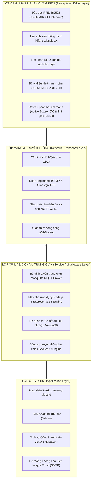

_Hình 2.1: Kiến trúc phân tầng kinh điển 4 lớp trong hệ sinh thái Smart Library Kiosk_

Mỗi phân lớp trong kiến trúc trên đảm nhiệm một vai trò chuyên biệt, độc lập logic nhưng tương hỗ chặt chẽ:

- **Lớp cảm nhận:** Đảm bảo tính trung thực và tốc độ thu nhận mã định danh từ thế giới thực.
- **Lớp mạng:** Chuyển tải thông tin qua môi trường vô tuyến mà không làm tắc nghẽn băng thông của trường học.
- **Lớp dịch vụ trung gian:** Đóng vai trò bộ não, nơi xử lý logic nghiệp vụ, đối chiếu cơ sở dữ liệu và ban hành lệnh điều khiển.
- **Lớp ứng dụng:** Cung cấp trải nghiệm tương tác tự nhiên, thân thiện và chính xác cho người dùng đầu cuối.

---

### 2.2. Nguyên lý nhận dạng sóng vô tuyến RFID/NFC tần số cao (HF 13.56 MHz)

#### a) Hiện tượng ghép cảm ứng điện từ trường (Inductive Coupling)

Khác với dải tần UHF ($860 - 960\text{ MHz}$) sử dụng nguyên lý tán xạ ngược sóng vô tuyến trường xa (Backscatter Coupling), công nghệ RFID tần số cao **HF 13.56 MHz** hoạt động dựa trên nguyên lý **ghép cảm ứng điện từ trường gần (Near-Field Magnetic Inductive Coupling)** theo hệ thức kinh điển của Maxwell-Faraday.

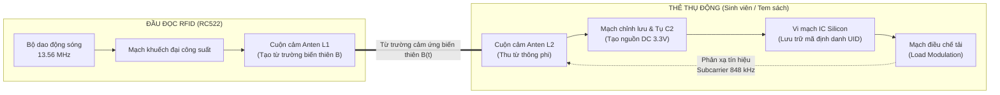

_Hình 2.2: Sơ đồ nguyên lý ghép cảm ứng điện từ và điều chế tải giữa đầu đọc và thẻ RFID_

Khi dòng điện xoay chiều tần số $f_0 = 13.56\text{ MHz}$ chạy qua cuộn dây anten $L_1$ của module RC522, nó sinh ra một từ trường biến thiên $B(t)$ trong không gian lân cận. Khi thẻ sinh viên đi vào vùng từ trường này, từ thông $\Phi(t)$ xuyên qua cuộn dây anten $L_2$ của thẻ sẽ sinh ra một sức điện động cảm ứng $e(t)$ theo Định luật Faraday:
$$e(t) = -N_2 \frac{d\Phi(t)}{dt} = -N_2 \frac{d}{dt} \iint_S \vec{B}(t) \cdot d\vec{S}$$

Điện áp cảm ứng xoay chiều này được chỉnh lưu qua mạch cầu diode tích hợp bên trong thẻ, nạp đầy cho tụ điện song song $C_2$ để tạo thành nguồn điện một chiều ($V_{DD} \approx 2 - 3.3\text{V DC}$) nuôi sống chip silicon. Sau khi khởi động trong vài phần nghìn giây, chip bắt đầu phát lại chuỗi mã định danh duy nhất (UID 4-byte hoặc 7-byte) bằng kỹ thuật **Điều chế tải (Load Modulation)** trên sóng mang phụ $848\text{ kHz}$. Đầu đọc RC522 cảm nhận sự biến đổi dòng điện trên cuộn dây $L_1$ của mình để giải mã chuỗi bit dữ liệu.

#### b) So sánh các chuẩn công nghệ RFID trong bài toán Thư viện

_Bảng 2.1: So sánh đặc tính kỹ thuật các dải tần số công nghệ RFID phổ biến_
| Thuộc tính kỹ thuật | RFID LF (Thấp) | RFID HF (Cao - Đề tài sử dụng) | RFID UHF (Siêu cao) |
| :--- | :--- | :--- | :--- |
| **Dải tần số danh định** | $125 - 134.2\text{ kHz}$ | **$13.56\text{ MHz}$** | $860 - 960\text{ MHz}$ |
| **Tiêu chuẩn quốc tế** | ISO 11784 / 11785 | **ISO/IEC 14443A / ISO 15693** | ISO/IEC 18000-6C (EPC Gen2) |
| **Khoảng cách nhận diện** | $< 5\text{ cm}$ | **$2\text{ cm} - 10\text{ cm}$** | $1\text{ m} - 10\text{ m}$ |
| **Tốc độ truyền dữ liệu** | Rất chậm ($\approx 2\text{ kbps}$) | **Nhanh ($106 - 424\text{ kbps}$)** | Rất nhanh ($40 - 640\text{ kbps}$) |
| **Khả năng xuyên qua chất lỏng/vật thể** | Tốt, ít bị hấp thụ | **Tốt, ổn định cao** | Kém, dễ bị phản xạ kim loại & nước |
| **Giá thành module đọc** | Rẻ ($\approx 40.000\text{đ}$) | **Cực rẻ ($\approx 28.000\text{đ}$)** | Rất đắt ($1.500.000 - 5.000.000\text{đ}$) |
| **Ứng dụng tối ưu** | Kiểm soát ra vào cửa | **Kiosk tự phục vụ, Thẻ sinh viên** | Cổng an ninh chống trộm, Kho lớn |

👉 **Lý do lựa chọn RFID HF 13.56 MHz (RC522):**

1. **Kiểm soát vùng đọc chính xác:** Cự ly đọc lý tưởng $2 - 5\text{ cm}$ ngăn chặn hiện tượng "quét nhầm" sách của người đứng bên cạnh hoặc sách đang để trên bàn chờ.
2. **Tương thích hoàn hảo với Thẻ sinh viên PTIT:** Các phôi thẻ sinh viên liên kết ngân hàng của trường đều tích hợp chip Mifare HF 13.56 MHz.
3. **Hiệu quả kinh tế vượt trội:** Chi phí phần cứng rẻ hơn gấp 50 lần so với đầu đọc UHF, phù hợp triển khai số lượng lớn trạm Kiosk.

---

### 2.3. Bộ vi điều khiển trung tâm ESP32 và Khối ngoại vi biên

#### a) Kiến trúc điện toán của SoC ESP32

Dự án sử dụng bo mạch vi điều khiển **ESP32 WiFi Bluetooth CH340 Type-C phiên bản 30 chân (Model: PVN12681)**, tích hợp module lõi SoC ESP32-WROOM-32:

- **Bộ vi xử lý trung tâm:** Sử dụng kiến trúc 32-bit Xtensa Dual-Core LX6 với 2 nhân xử lý độc lập (Core 0 chuyên trách ngăn xếp giao thức không dây Wi-Fi/Bluetooth, Core 1 chạy chương trình ứng dụng thời gian thực). Xung nhịp hoạt động điều chỉnh linh hoạt từ $80\text{ MHz}$ lên tới $240\text{ MHz}$.
- **Bộ nhớ trên chip:** Sở hữu $520\text{ KB SRAM}$ nội bộ và $4\text{ MB SPI Flash}$ ngoài, cho phép thực thi các thuật toán mã hóa JSON phức tạp, duy trì bộ đệm truyền thông và hỗ trợ cập nhật Firmware qua sóng vô tuyến (OTA Update).
- **Giao tiếp nạp và cấp nguồn hiện đại:** Bo mạch tích hợp chip cầu chuyển đổi **USB-to-UART CH340** cùng cổng cắm chuẩn **USB Type-C**, giúp việc cấp nguồn $5\text{V DC}$ và nạp chương trình diễn ra ổn định, tốc độ truyền baudrate nạp đạt tới $921600\text{ bps}$.
- **Khối ngoại vi tích hợp:** Cung cấp 30 chân ra (Pinout) bao gồm các giao tiếp phần cứng chuyên dụng: bus SPI tốc độ cao (kết nối đầu đọc RFID), I2C, UART, 16 kênh PWM và các chân Digital GPIO đa năng.

#### b) Cơ cấu phản hồi vật lý tại chỗ (Actuators) và Phụ kiện đấu nối

- **Còi báo Active Buzzer 5V (Model K3H19 - PVX81892):** Là loại còi chip chủ động tích hợp sẵn mạch dao động nội bên trong. Vi điều khiển chỉ cần cấp mức logic cao (`HIGH`) ra chân GPIO là còi phát ra âm thanh tần số cố định $\approx 2.5\text{ kHz}$ với cường độ âm thanh $\ge 85\text{ dB}$, giúp sinh viên dễ dàng nhận biết phản hồi ngay cả trong không gian thư viện mở.
- **Hệ thống LED chỉ thị đa trạng thái (Model K17H1 & K17H3):** Sử dụng đèn LED khuếch tán phủ màu đường kính $\Phi 5\text{mm}$ gồm **LED Đỏ (K17H1 - PVX81796)** và **LED Xanh Lá (K17H3 - PVX81795)**. Mỗi đèn LED được mắc nối tiếp với một điện trở màng carbon **$1/4\text{W}\ 5\%\ 220\,\Omega$ ($220\text{R}$ - PVX82358)** nhằm hạn chế dòng tải qua chân GPIO ở mức an toàn ($\approx 10 - 12\text{ mA}$).
- **Module RFID RC522 (PVX83339) & Header cắm thẳng (PVX81585):** Module sử dụng chip MFRC522 của NXP, được hàn nối với hàng rào cắm **Header $2.54\text{mm}$ đực thẳng 8 chân** để cắm chắc chắn vào bo test và giao tiếp bus SPI với vi điều khiển.
- **Bo cắm thử nghiệm Breadboard MB-102 (SP000189) & Cáp bẹ nối:** Sử dụng bo test MB-102 kích thước tiêu chuẩn $8.5 \times 5.5\text{ cm}$ (400 lỗ cắm) cùng bộ dây nối 7 màu $20\text{cm}$ chuẩn **Đực - Cái (PVN11641)** và **Đực - Đực (PVN11640)**, giúp việc bố trí linh kiện gọn gàng, cách ly chống chập mạch và không cần hàn chì cố định.

---

### 2.4. Phân tích chuyên sâu Ngăn xếp Giao thức Truyền thông IoT

```text
+-----------------------------------------------------------------------+
|                       LỚP ỨNG DỤNG (APPLICATION)                       |
|   MQTT v3.1.1 (Telemetry)   |   WebSocket / Socket.IO   |   HTTP REST  |
+-----------------------------------------------------------------------+
|                       LỚP GIAO VẬN (TRANSPORT)                         |
|                 TCP (Transmission Control Protocol)                   |
+-----------------------------------------------------------------------+
|                         LỚP MẠNG (NETWORK)                            |
|                     IPv4 / IPv6 Internet Protocol                     |
+-----------------------------------------------------------------------+
|                     LỚP LIÊN KẾT DỮ LIỆU & VẬT LÝ                     |
|           IEEE 802.11 b/g/n Wi-Fi           |     SPI Bus (RC522)     |
+-----------------------------------------------------------------------+
```

_Hình 2.3: Ngăn xếp phân tầng các giao thức truyền thông trong hệ sinh thái Kiosk_

#### a) Giao thức MQTT (Message Queuing Telemetry Transport)

MQTT là giao thức truyền thông theo mô hình Xuất bản / Đăng ký (Publish/Subscribe) hoạt động trên nền giao vận TCP/IP, được phát minh bởi Andy Stanford-Clark (IBM) và Arlen Nipper vào năm 1999 nhằm mục đích thu thập dữ liệu đo xa qua đường truyền vệ tinh băng thông hẹp.

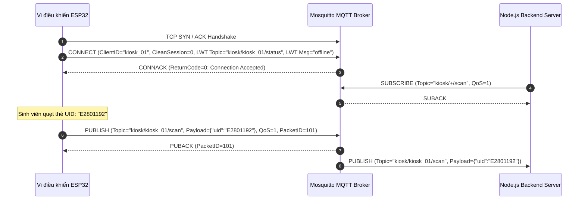

_Hình 2.4: Trình tự thiết lập kết nối, đăng ký nhận tin và truyền dữ liệu qua MQTT_

_Bảng 2.2: So sánh định lượng chi phí băng thông và độ trễ giữa MQTT và HTTP REST_
| Tiêu chí đo đạc | Giao thức MQTT | Giao thức HTTP REST |
| :--- | :--- | :--- |
| **Kích thước Header tối thiểu** | **$2\text{ bytes}$** | $\approx 200 - 800\text{ bytes}$ |
| **Cơ chế duy trì kết nối** | Duy trì 1 kết nối TCP duy nhất qua Keep-Alive PING | Thường xuyên mở/đóng TCP Handshake (3-way) |
| **Thời gian truyền 1 gói tin quét thẻ** | **$\approx 15 - 35\text{ ms}$** | $\approx 150 - 400\text{ ms}$ |
| **Cơ chế báo mất kết nối** | Có sẵn Di chúc kết nối (**LWT - Last Will**) | Không có, bắt buộc phải dùng Polling định kỳ |
| **Điện năng tiêu thụ trên vi điều khiển** | Rất thấp, CPU ngủ sâu giữa các gói tin | Cao do liên tục xử lý chuỗi Header HTTP |

- **Đặc tả cấp độ dịch vụ (QoS - Quality of Service):**
  - Đề tài áp dụng **QoS 1 (At least once)** cho các kênh dữ liệu nhạy cảm như quẹt thẻ `scan` và nhịp tim `status`. Cơ chế này sử dụng cặp bản tin `PUBLISH`/`PUBACK` có kèm `Packet Identifier` để bảo đảm thông điệp chắc chắn đến đích ít nhất một lần, chống mất gói khi mạng Wi-Fi trường học chập chờn.

#### b) Giao thức WebSocket và Thư viện Socket.IO

Trong khi MQTT đảm nhận luồng dữ liệu máy-đến-máy (M2M) giữa ESP32 và Server, giao thức **WebSocket (RFC 6455)** giải quyết bài toán đồng bộ thời gian thực lên trình duyệt Kiosk.

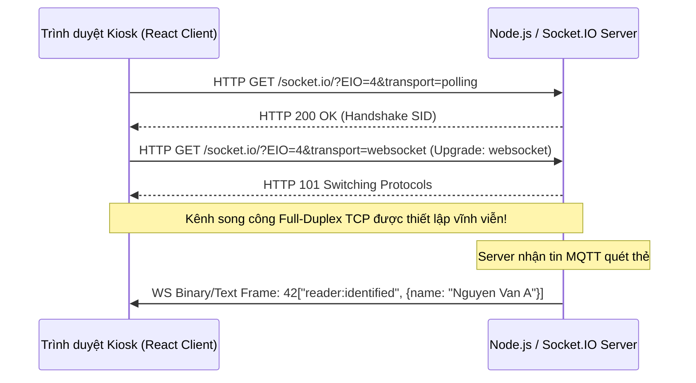

_Hình 2.5: Quy trình nâng cấp kết nối từ HTTP sang Full-Duplex WebSocket_

Khác với kỹ thuật Polling truyền thống (trình duyệt cứ mỗi 1 giây lại gửi 1 HTTP Request hỏi _"Có thẻ mới chưa?"_ làm nghẽn Server), Socket.IO duy trì một kết nối TCP liên tục. Khi Backend nhận được thông điệp MQTT từ ESP32, nó sẽ chủ động phát (Emit) sự kiện thẳng xuống màn hình Kiosk với độ trễ gần như bằng $0$.

---

### 2.5. Nền tảng Máy chủ Backend Node.js & Kiến trúc Hướng sự kiện (Event-Driven)

Node.js sử dụng kiến trúc đơn luồng (Single-Threaded Event Loop) kết hợp với thư viện lập trình hệ thống `libuv`. Mọi thao tác đọc ghi cơ sở dữ liệu MongoDB, phát gói tin mạng hay gửi email đều được đẩy xuống tầng nhân hệ điều hành xử lý bất đồng bộ thông qua mô hình Non-blocking I/O. Điều này giúp máy chủ Kiosk tiêu tốn cực ít bộ nhớ RAM nhưng vẫn có thể duy trì hàng ngàn kết nối thiết bị đồng thời mà không bị tắc nghẽn (Thread Starvation) như các mô hình đa luồng truyền thống.

---

### 2.6. Hệ quản trị Cơ sở dữ liệu phi quan hệ MongoDB

MongoDB tổ chức dữ liệu dưới dạng các tài liệu BSON (Binary JSON). Trong hệ thống thư viện Kiosk:

- **Khả năng lồng ghép tài liệu (Embedded Documents):** Một phiếu mượn (`Loan`) có thể nhúng trực tiếp thông tin chi tiết của cuốn sách (`Book`) và độc giả (`Reader`) tại thời điểm mượn, giúp việc truy vấn lịch sử không cần qua nhiều phép nối bảng (`JOIN`) phức tạp, tăng tốc độ đọc dữ liệu lên gấp $5 - 10\text{ lần}$.
- **Chỉ mục tìm kiếm (Indexing):** Các trường định danh như `studentId`, `rfidCard` và `rfidTag` đều được đánh chỉ mục dạng cây $B\text{-Tree}$ (`unique: true`), bảo đảm thời gian tra cứu bản ghi đạt độ phức tạp thuật toán $O(\log N)$, tương đương thời gian thực hiện chỉ dưới $2\text{ ms}$.

---

### 2.7. Tích hợp Chuẩn thanh toán mở VietQR và Dịch vụ Email tự động

- **Cơ chế tạo mã VietQR theo chuẩn EMVCo:** Hệ thống ứng dụng chuẩn định dạng mã QR thanh toán quốc tế của EMVCo và mạng lưới thanh toán bù trừ liên ngân hàng Napas247. Chuỗi dữ liệu mã hóa động theo cấu trúc TLV (Tag-Length-Value) chứa mã BIN ngân hàng thụ hưởng (`970422` - MB Bank), số tài khoản cá nhân/thư viện (`000124135246`), số tiền phạt quá hạn chính xác và mã giao dịch kèm MSSV của sinh viên.
- **Tự động hóa biên lai qua SMTP (Nodemailer):** Dịch vụ kết nối trực tiếp với cổng SMTP bảo mật (TLS/SSL Port 587) của Google, biên dịch mã HTML động tạo thành bức thư điện tử trang trọng, đóng dấu chứng nhận số của Học viện PTIT và tự động gửi tới hòm thư sinh viên ngay khi giao dịch kết thúc.

---

# CHƯƠNG 3. PHÂN TÍCH VÀ THIẾT KẾ HỆ THỐNG TOÀN DIỆN

### 3.1. Phân tích Yêu cầu Hệ thống

#### a) Yêu cầu chức năng (Functional Requirements - FR)

- **FR01 - Nhận diện danh tính sinh viên:** Đọc thẻ RFID sinh viên, kiểm tra trạng thái kích hoạt trong hệ thống và hiển thị hồ sơ cá nhân.
- **FR02 - Mượn sách theo lô (Batch Scanning):** Cho phép sinh viên quẹt liên tục nhiều cuốn sách vào giỏ mượn trong cùng một phiên, tự động cập nhật hạn trả $+14\text{ ngày}$ khi bấm xác nhận.
- **FR03 - Trả sách tự phục vụ:** Tự động tra soát phiếu mượn tương ứng của cuốn sách, kiểm tra thời hạn mượn và cập nhật kho sách.
- **FR04 - Tính toán và Khóa cưỡng chế nộp phạt:** Tự động tính tiền phạt ($5.000\text{ đ/ngày}$) đối với các sách trễ hạn, hiển thị mã VietQR động và **khóa hoàn toàn nút hoàn tất trả sách** cho đến khi sinh viên nộp phạt thành công.
- **FR05 - Gia hạn tài liệu:** Cho phép gia hạn thêm $14\text{ ngày}$ cho các cuốn sách còn hạn và chưa vượt quá số lần gia hạn cho phép (tối đa $2\text{ lần}$).
- **FR06 - Phát hành biên lai điện tử:** Sinh mã vạch giao dịch E-Ticket trên màn hình và gửi đúng $1\text{ email}$ biên lai tổng hợp về hộp thư của bạn đọc.
- **FR07 - Chống chiếm quyền phiên (Anti-Session Hijacking):** Chặn đứng mọi hành vi quẹt thẻ của người khác khi một sinh viên đang trong phiên làm việc chưa kết thúc.
- **FR08 - Giám sát sức khỏe thiết bị:** Thủ thư theo dõi được trạng thái Online/Offline, cường độ sóng Wi-Fi RSSI và nhật ký quét thẻ của từng trạm Kiosk.
- **FR09 - Điều khiển trạm Kiosk từ xa:** Cho phép thủ thư gửi lệnh kích hoạt còi báo hoặc khởi động lại vi điều khiển ESP32 từ xa qua web.

#### b) Yêu cầu phi chức năng (Non-Functional Requirements - NFR)

- **NFR01 - Hiệu năng thời gian thực (Performance):** Tổng thời gian từ khi quẹt thẻ vật lý đến khi thông tin hiển thị trên màn hình không quá $300\text{ ms}$.
- **NFR02 - Độ tin cậy (Reliability):** Mạch ESP32 phải tự động phục hồi kết nối Wi-Fi và MQTT khi bộ phát mạng bị khởi động lại mà không cần người can thiệp thủ công.
- **NFR03 - Công thái học giao diện (Ergonomics):** Kích thước các nút bấm trên màn hình cảm ứng tối thiểu đạt $48 \times 48\text{ pixels}$, phông chữ hiển thị rõ ràng từ cự ly $60\text{ cm}$.

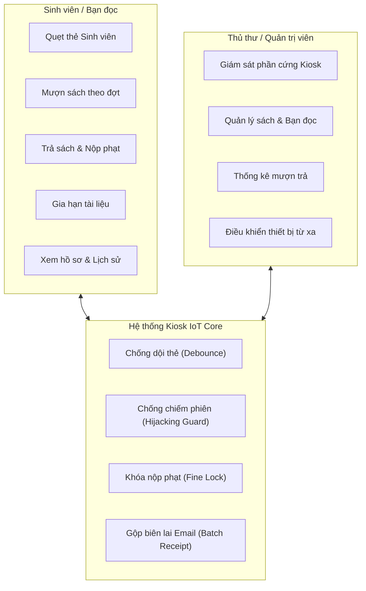

_Hình 3.1: Biểu đồ trường hợp sử dụng (Use Case) tổng thể của hệ thống Kiosk_

---

### 3.2. Thiết kế Kiến trúc Tổng thể & Phân cấp IoT Level

#### a) Kiến trúc Vật lý 3 tầng (3-Tier Physical Architecture)

Hệ thống được tổ chức thành 3 tầng vật lý phân tách hoàn toàn:

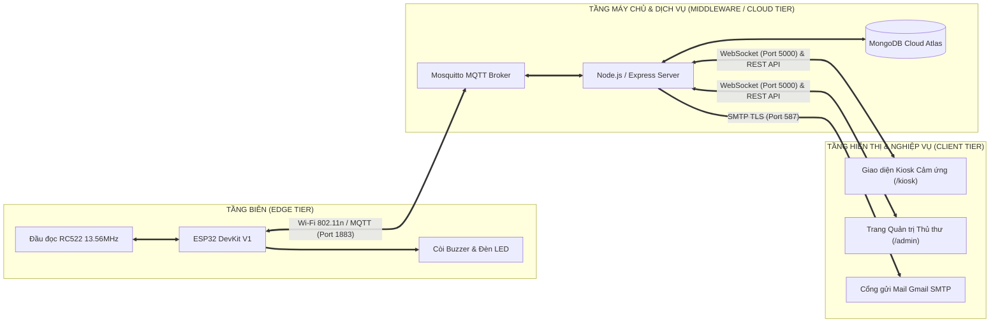

_Hình 3.2: Sơ đồ kiến trúc vật lý 3 tầng hoàn chỉnh của hệ sinh thái Kiosk_

#### b) Phân tích Cấp độ Kiến trúc IoT theo Tiêu chuẩn Bahga & Madisetti

Theo tài liệu học thuật kinh điển *"Internet of Things: A Hands-On Approach"* của **Arshdeep Bahga và Vijay Madisetti**, hệ thống **IoT Level 3** được định nghĩa với cấu trúc đặc trưng:
> *"An IoT Level 3 system has a single node. The data is stored in the cloud and application is cloud-based. Data analysis is performed in the cloud."*  
> *(Hệ thống IoT Level 3 bao gồm một nút cảm nhận/tác động đơn. Dữ liệu được lưu trữ trên Đám mây và ứng dụng được xây dựng trên Đám mây. Toàn bộ quá trình phân tích dữ liệu được thực thi tập trung trên Đám mây).*

Đề tài **Smart Library Kiosk** được thiết kế và hiện thực hóa chuẩn mực theo đúng các thành phần cốt lõi của **IoT Level 3**:

1. **Nút cảm nhận & chấp hành biên (Sensing & Actuation Node):**  
   Trạm Kiosk vật lý sử dụng vi điều khiển ESP32 đóng vai trò nút biên (Single Node), kết nối module RFID RC522 (Cảm nhận thẻ độc giả/thẻ sách) và các cơ cấu chấp hành chỉ thị âm thanh/ánh sáng (Active Buzzer, LED trạng thái). Nút biên này vận hành siêu nhẹ (Lightweight), chỉ đảm nhiệm việc đọc mã UID thô và phản hồi cơ cấu ngoại vi theo lệnh, hoàn toàn không lưu trữ dữ liệu nghiệp vụ tại chỗ.
2. **Lưu trữ và Phân tích Dữ liệu trên Đám mây (Cloud-based Storage & Analytics):**  
   Mọi dữ liệu định danh, trạng thái sách, lịch sử mượn trả đều được lưu trữ phân tán trên **MongoDB Atlas Cloud**. Toàn bộ giải thuật xử lý và phân tích nghiệp vụ phức tạp (kiểm tra điều kiện mượn, phát hiện xung đột dữ liệu đồng thời, tính toán phí phạt trễ hạn $5.000\text{ đ/ngày}$, sinh chuỗi thanh toán VietQR Napas247, gộp biên lai và phát hành email SMTP) được thực thi tập trung $100\%$ tại tầng máy chủ Đám mây (**Node.js Cloud Engine** trên nền tảng Fly.io).
3. **Ứng dụng trên nền tảng Đám mây (Cloud-based Application):**  
   Cả giao diện màn hình Kiosk tự phục vụ (`/kiosk`) và Trung tâm điều hành của thủ thư (`/admin`) đều là ứng dụng đám mây độc lập được triển khai trên mạng lưới CDN toàn cầu của Vercel, kết nối song công thời gian thực với Cloud Server qua WebSocket (Socket.IO).

##### *Biện luận Học thuật: Khẳng định tính chuẩn xác của Kiến trúc IoT Level 3*
Để chứng minh sự lựa chọn kiến trúc IoT Level 3 là hoàn toàn tối ưu và chuẩn xác cho bài toán Kiosk thư viện, nhóm đã thực hiện phân tích đối chiếu với các cấp độ khác:
- **So sánh với IoT Level 1 & Level 2:** Các cấp độ này đòi hỏi việc lưu trữ hoặc phân tích dữ liệu phải diễn ra cục bộ (Locally) ngay trên thiết bị biên. Điều này hoàn toàn bất khả thi trong quản lý thư viện hiện đại vì tài nguyên phần cứng của vi điều khiển không thể lưu trữ hàng vạn bản ghi sách và độc giả, đồng thời gây phân mảnh và mất tính toàn vẹn dữ liệu giữa các phiên giao dịch.
- **So sánh với IoT Level 4:** Theo định nghĩa của Bahga & Madisetti, hệ thống IoT Level 4 bắt buộc nút thiết bị biên phải thực hiện **Local Analysis** (phân tích cục bộ) trước khi gửi kết quả lên Đám mây. Trong nghiệp vụ Kiosk thư viện, việc đẩy thuật toán tính phạt hay kiểm tra sách về vi điều khiển biên là thừa thãi, làm tăng chi phí phần cứng không cần thiết, gia tăng nguy cơ không nhất quán dữ liệu (Data Inconsistency) và dễ bị tấn công can thiệp phần cứng. Do đó, việc tập trung toàn bộ năng lực phân tích lên Cloud chính là giải pháp kinh điển, an toàn và tối ưu nhất của **IoT Level 3**.

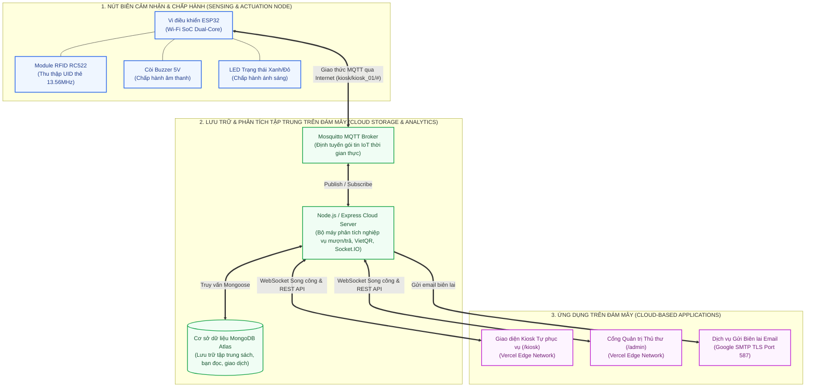

_Hình 3.3: Lược đồ kiến trúc hệ thống chuẩn IoT Level 3 (theo mô hình Arshdeep Bahga & Vijay Madisetti)_

---

### 3.3. Thiết kế Phần cứng và Nguyên lý Hoạt động

_Bảng 3.2: Danh mục linh kiện phần cứng thực tế trang bị cho trạm Kiosk_
| STT | Mã linh kiện | Tên linh kiện / Module | Thông số kỹ thuật & Quy cách | Số lượng | Vai trò nhiệm vụ trong trạm Kiosk |
| :---: | :---: | :--- | :--- | :---: | :--- |
| 1 | **PVN12681** | Bo mạch ESP32 WiFi Bluetooth CH340 Type-C (30 chân) | Vi điều khiển SoC ESP32-WROOM-32 (2 nhân 240MHz), 30 chân GPIO, IC nạp CH340, cổng kết nối Type-C | 1 Chiếc | Bộ điều khiển trung tâm, kết nối mạng Wi-Fi 2.4GHz, đọc bus SPI và truyền thông MQTT. |
| 2 | **PVX83339** | Module đọc thẻ RFID RC522 13.56MHz | IC MFRC522 (NXP), tần số sóng vô tuyến 13.56 MHz, giao tiếp bus SPI, cự ly nhận diện $2 - 5\text{ cm}$ | 1 Chiếc | Cảm biến nhận diện thẻ sinh viên và tem nhãn dán trên tài liệu thư viện. |
| 3 | **PVX81585** | Header 2.54mm Đực Thẳng - 8 Chân (K10F6-1) | Bước chân tiêu chuẩn 2.54mm, 8 chân kim loại thẳng mạ thiếc | 1 Chiếc | Hàn/cắm cố định hàng chân giao tiếp SPI (SDA, SCK, MOSI, MISO, IRQ, GND, RST, 3.3V) cho module RC522. |
| 4 | **PVX81892** | Còi Chip Active Buzzer 5V (Model K3H19) | Còi báo chủ động tích hợp dao động trong, kích hoạt mức logic cao (`HIGH`), điện áp $3.3 - 5\text{V}$, âm lượng $\ge 85\text{dB}$ | 2 Chiếc | Phát âm thanh phản hồi bíp khi quét thẻ hợp lệ hoặc còi cảnh báo khi xảy ra lỗi. |
| 5 | **PVX81795** | LED Phủ Màu 5mm - Xanh Lá (Model K17H3) | LED khuếch tán $\Phi 5\text{mm}$, điện áp kích $2.0 - 2.2\text{V}$, dòng định mức $15\text{mA}$ | 1 Gói (10 con) | Đèn chỉ báo thị giác trạng thái quét thẻ thành công / giao dịch hợp lệ tại mặt máy Kiosk. |
| 6 | **PVX81796** | LED Phủ Màu 5mm - Đỏ (Model K17H1) | LED khuếch tán $\Phi 5\text{mm}$, điện áp kích $1.8 - 2.0\text{V}$, dòng định mức $15\text{mA}$ | 1 Gói (10 con) | Đèn cảnh báo lỗi quẹt thẻ lạ, từ chối thẻ hoặc sách quá hạn chưa hoàn tất nộp phạt. |
| 7 | **PVX82358** | Điện trở vạch 1/4W 5% - 220R (220 Ohm) | Điện trở màng carbon 4 vạch màu (Đỏ-Đỏ-Nâu-Vàng kim), công suất $0.25\text{W}$, sai số $5\%$ | 1 Gói (50 con) | Mắc nối tiếp hạn dòng bảo vệ các đèn LED 5mm không làm quá tải chân xuất GPIO của ESP32. |
| 8 | **SP000189** | Board Test MB-102 (Breadboard 400 lỗ) | Kích thước chuẩn $8.5 \times 5.5\text{ cm}$, 400 lỗ cắm tiếp xúc lá đồng, có rãnh cách điện giữa | 1 Chiếc | Bo cắm thử nghiệm phần cứng không cần hàn, gá lắp chắc chắn module RC522, LED và Buzzer. |
| 9 | **PVN11641** | Dây Nối 7 Màu 20cm - Đực Cái | Cáp bẹ dẹt 7 màu, chiều dài 20cm, một đầu đực (kim nhọn) và một đầu cái (lỗ cắm) | 1 Bó (10 sợi) | Nối trực tiếp từ các chân kim của ESP32 sang các hàng lỗ cắm trên Breadboard / Module RC522. |
| 10 | **PVN11640** | Dây Nối 7 Màu 20cm - Đực Đực | Cáp bẹ dẹt 7 màu, chiều dài 20cm, hai đầu kim đực chuẩn 2.54mm | 1 Bó (10 sợi) | Nối cầu tín hiệu giữa các hàng lỗ trên Breadboard và chia sẻ các đường cấp nguồn 3.3V/GND. |

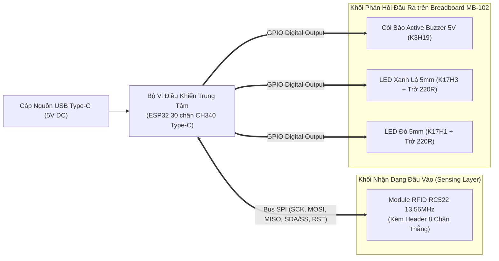

_Hình 3.5: Sơ đồ khối nguyên lý kết nối phần cứng trạm Kiosk_

> _[HÃY ĐIỀN CÁCH LẮP CHÂN VÀO ĐÂY]_  
> _(Ghi chú dành cho sinh viên: Sau khi hoàn thiện khâu cắm dây thực tế trên breadboard, hãy lập một bảng đối chiếu chi tiết các chân kết nối vật lý giữa Module RC522, Buzzer, LED với các chân GPIO tương ứng của ESP32 và dán vào vị trí này)._

---

### 3.4. Thiết kế Giao tiếp Truyền thông MQTT

_Bảng 3.3: Đặc tả bảng phân cấp Topic MQTT và cấu trúc JSON Payload tiêu chuẩn_
| Chiều truyền dữ liệu | Cấu trúc Tên Topic | Cấp QoS | Cấu trúc Payload mẫu (JSON Standard) | Mô tả nghiệp vụ |
| :--- | :--- | :---: | :--- | :--- |
| **ESP32 $\rightarrow$ Server** | `kiosk/kiosk_01/scan` | **1** | `{"uid": "E2801192", "type": "rfid", "timestamp": 1741234567}` | Bắn mã định danh thẻ vừa quét từ đầu đọc lên Server. |
| **ESP32 $\rightarrow$ Server** | `kiosk/kiosk_01/status` | **1** | `{"status": "online", "rssi": -62, "uptime": 3600, "ip": "192.168.1.15"}` | Báo cáo nhịp tim định kỳ $30\text{s/lần}$ kèm độ mạnh sóng Wi-Fi. |
| **ESP32 $\rightarrow$ Server** | `kiosk/kiosk_01/status` _(LWT)_ | **1** | `{"status": "offline", "reason": "connection_lost"}` | Thông điệp Di chúc tự động kích hoạt khi mạch mất nguồn/mất mạng. |
| **Server $\rightarrow$ ESP32** | `kiosk/kiosk_01/command` | **0** | `{"action": "feedback", "status": "success", "duration": 100}` | Ra lệnh còi kêu 1 tiếng bíp ngắn và nháy LED xanh. |
| **Server $\rightarrow$ ESP32** | `kiosk/kiosk_01/command` | **0** | `{"action": "feedback", "status": "error", "duration": 300}` | Ra lệnh còi kêu 3 tiếng bíp dồn dập và nháy LED đỏ. |
| **Server $\rightarrow$ ESP32** | `kiosk/kiosk_01/command` | **0** | `{"action": "reboot"}` | Ra lệnh khởi động lại mềm (Soft Reset) vi điều khiển ESP32 từ xa. |

---

### 3.5. Thiết kế Cơ sở dữ liệu Thực thể Liên kết (ERD)

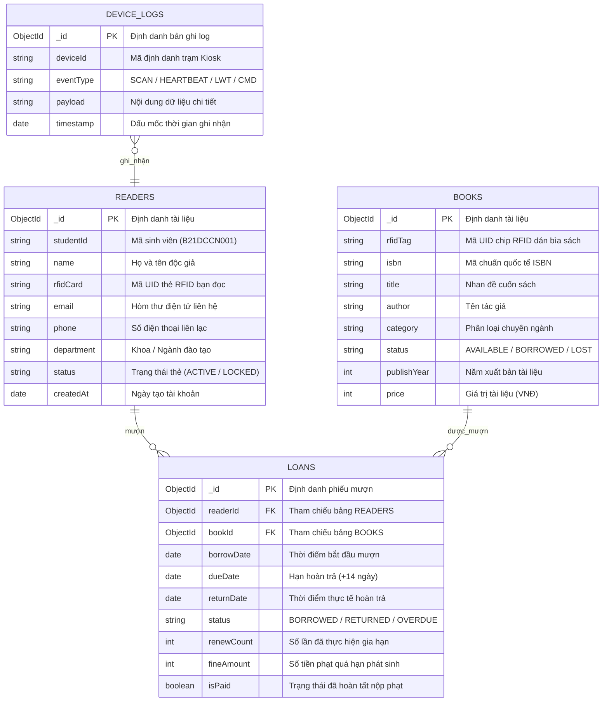

_Hình 3.6: Lược đồ quan hệ thực thể (ERD) trên hệ quản trị MongoDB_

---

### 3.6. Thiết kế Giao tiếp RESTful API và Sự kiện WebSocket (Socket.IO)

_Bảng 3.4: Bảng đặc tả chi tiết các RESTful API Endpoints của hệ sinh thái_
| Phương thức | Đường dẫn Endpoint | Mã phản hồi HTTP | Mục đích và Hành động nghiệp vụ |
| :---: | :--- | :---: | :--- |
| `GET` | `/api/readers/rfid/:rfid` | `200`, `404` | Tra cứu hồ sơ sinh viên và danh mục các tài liệu đang mượn từ mã thẻ RFID. |
| `POST` | `/api/loans/borrow` | `200`, `400`, `409` | Xác nhận mượn theo đợt toàn bộ danh mục sách có trong giỏ, tạo hạn trả $+14\text{ ngày}$. |
| `POST` | `/api/loans/return` | `200`, `404` | Quét nhận một cuốn sách trả, tính toán tiền phạt lũy tiến nếu vượt quá hạn trả. |
| `POST` | `/api/loans/renew` | `200`, `400` | Gia hạn thêm $14\text{ ngày}$ cho danh mục sách đã chọn (từ chối sách quá hạn hoặc hết lần). |
| `POST` | `/api/loans/pay-fine` | `200`, `400` | Xác nhận bạn đọc đã hoàn tất thanh toán khoản phạt quá hạn qua VietQR. |
| `POST` | `/api/loans/finish-return` | `200`, `400` | Kết thúc phiên trả sách, giải phóng giao diện và gửi đúng $1\text{ email}$ biên lai tổng hợp. |
| `GET` | `/api/devices` | `200` | Cung cấp danh sách các trạm Kiosk và trạng thái nhịp tim Online/Offline cho Admin. |
| `POST` | `/api/devices/command` | `200`, `500` | Phát lệnh điều khiển kiểm tra còi/đèn hoặc khởi động lại vi điều khiển ESP32 từ xa. |

---

### 3.7. Thiết kế Thuật toán và Luồng Xử lý Nghiệp vụ Cốt lõi

#### a) Thuật toán Nhận diện Bạn đọc và Chống chiếm quyền phiên (Anti-Session Hijacking)

Trong môi trường công cộng đông đúc, nguy cơ một sinh viên B quẹt thẻ chen ngang khi sinh viên A chưa bấm hoàn tất phiên là rất lớn. Thuật toán sau đây triệt tiêu hoàn toàn lỗ hổng bảo mật này:

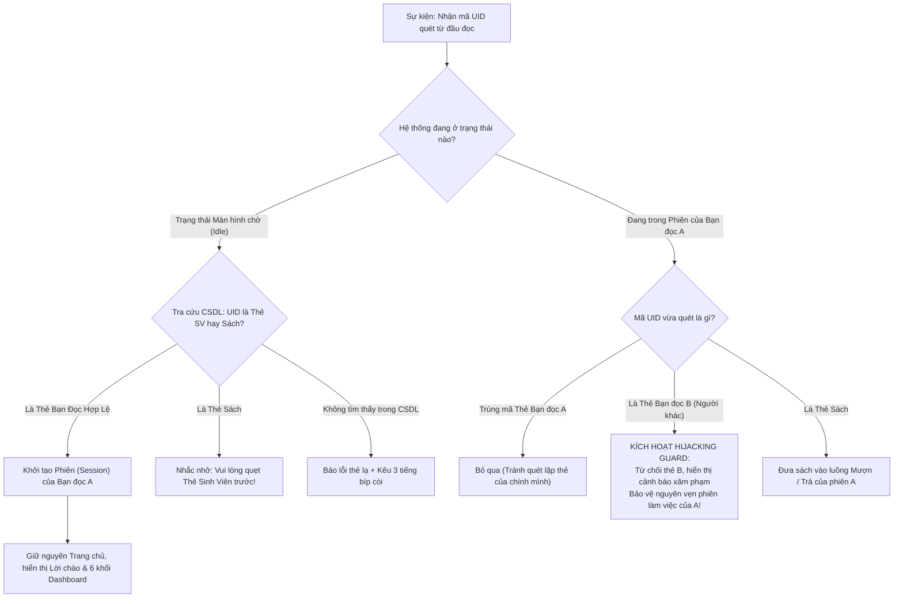

_Hình 3.7: Lưu đồ thuật toán quy trình Quẹt thẻ nhận diện & Chống chiếm quyền phiên_

#### b) Thuật toán Mượn sách theo đợt (Batch Borrowing)

Sinh viên có nhu cầu mượn nhiều cuốn giáo trình không phải lặp lại thao tác xác nhận nhiều lần:

1. Sinh viên chuyển vào mục **"Mượn tài liệu"**.
2. Quẹt lần lượt từng cuốn sách lên đầu đọc RC522.
3. Mỗi lần quẹt, Server kiểm tra trạng thái sách:
   - Nếu sách đang có độc giả khác mượn: Kêu còi cảnh báo lỗi, không cho phép mượn.
   - Nếu sách có sẵn trong kho: Đưa cuốn sách vào **Giỏ mượn sách thời gian thực**, còi kêu 1 tiếng bíp ngắn xác nhận.
4. Sinh viên có thể bấm xóa cuốn sách khỏi giỏ nếu đổi ý.
5. Khi kết thúc, bấm **"Xác nhận mượn tất cả"**: Hệ sinh thái Backend thực hiện một giao dịch nguyên tử (Atomic Database Transaction), đồng loạt ghi nhận ngày mượn, tính ngày hẹn trả $+14\text{ ngày}$ và gửi email biên lai xác nhận.

#### c) Thuật toán Trả sách và Khóa cưỡng chế nộp phạt trực tuyến VietQR

Nhằm loại bỏ tình trạng sinh viên trả sách quá hạn nhưng không nộp phạt lẻ rồi bỏ đi:

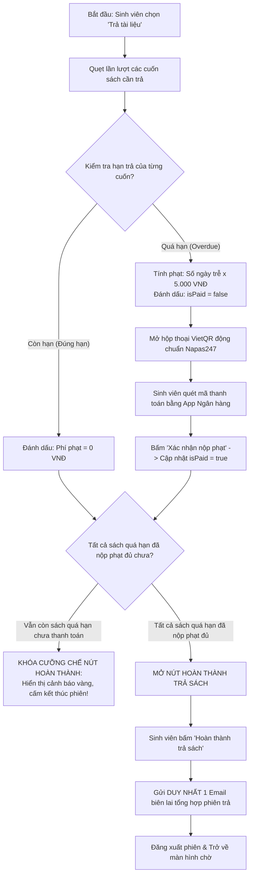

_Hình 3.9: Lưu đồ thuật toán quy trình Trả sách và Khóa nộp phạt VietQR_

---

# CHƯƠNG 4. TRIỂN KHAI VÀ HIỆN THỰC HÓA HỆ THỐNG

### 4.1. Môi trường Phát triển và Hệ sinh thái Công nghệ

Hệ thống được hiện thực hóa dựa trên hệ sinh thái phần cứng thực nghiệm và môi trường phần mềm tiêu chuẩn:

- **Hạ tầng phần cứng thực nghiệm:** Bo mạch vi điều khiển ESP32 30 chân nạp qua cổng USB Type-C (IC nạp CH340), Module đọc thẻ RFID RC522 tần số 13.56 MHz (kèm hàng rào cắm thẳng Header 8 chân 2.54mm), 2 còi chip Active Buzzer 5V K3H19, cụm LED phủ màu 5mm (Đỏ K17H1, Xanh lá K17H3), điện trở hạn dòng 220R 1/4W, bo cắm thử nghiệm Breadboard MB-102 (400 lỗ, $8.5 \times 5.5\text{ cm}$) cùng hệ thống cáp nối 7 màu 20cm chuẩn Đực - Cái và Đực - Đực.
- **Môi trường lập trình nhúng:** Visual Studio Code tích hợp PlatformIO IDE, Arduino C++ Framework.
- **Môi trường máy chủ và cơ sở dữ liệu:** Node.js v18 LTS, Eclipse Mosquitto MQTT Broker v2.0, MongoDB v7.0.
- **Môi trường giao diện người dùng:** React 18, Vite Bundler, Tailwind CSS v3.4.

_Bảng 4.1: Ma trận công nghệ và môi trường phát triển toàn diện của dự án_
| Phân hệ hệ thống | Ngôn ngữ / Công nghệ | Phiên bản | Thư viện & Công cụ chính |
| :--- | :--- | :---: | :--- |
| **Firmware nhúng biên** | C++ (Arduino Framework) | v2.0+ | PlatformIO, MFRC522 (v1.4.10), PubSubClient (v2.8), ArduinoJson (v6.21.3) |
| **Backend & MQTT Gateway**| JavaScript (Node.js LTS) | v20 LTS | Express (v4.19), Mongoose (v8.3), MQTT.js (v5.5), Socket.IO (v4.7), Nodemailer (v10.1) |
| **Cơ sở dữ liệu** | NoSQL Document Database | v7.0 | MongoDB Community Server / MongoDB Cloud Atlas |
| **Frontend Kiosk & Admin** | React.js SPA (Vite Engine) | React 18 | Tailwind CSS (v3.4), Lucide React (v0.372), Axios, React Router v6 |
| **Container hóa (DevOps)** | Docker & Docker Compose | Docker v26+ | Multi-stage build, Nginx Alpine Reverse Proxy, Mosquitto 2.0 |
| **Hạ tầng Đám mây** | Cloud PaaS & CDN | 2026 Platform | Fly.io (Backend Singapore Region), Vercel (Frontend Global Edge Network) |
| **Tự động hóa CI/CD** | GitHub Actions Pipeline | v4 Actions | Tự động kiểm thử cú pháp, build Docker Image và auto-deploy |

---

### 4.2. Hiện thực hóa Firmware trên ESP32

Firmware được module hóa thành các tệp nguồn C++ chuyên biệt trong thư mục `firmware/src/`:

1. **Khởi tạo và Quản lý kết nối mạng (`wifi_manager.cpp`):**
   - Sử dụng thư viện `WiFi.h`.
   - Cung cấp hàm `checkWiFiConnection()` được gọi lặp liên tục trong hàm `loop()` để tự động phục hồi kết nối mạng mà không sử dụng hàm trễ chặn (`delay()`), bảo đảm vi điều khiển không bao giờ bị rơi vào trạng thái "treo" (WDT Reset).
2. **Quản lý giao tiếp Bus SPI và Chống dội thẻ (`rfid_reader.cpp`):**
   - Giao tiếp với đầu đọc RC522 qua các chân phần cứng SPI tốc độ cao.
   - **Thuật toán Debounce $1500\text{ ms}$:** Ghi nhớ mã UID của thẻ vừa đọc cùng biến thời gian `millis()`. Trong vòng $1.5\text{ giây}$, nếu thẻ đó vẫn nằm trên đầu đọc, hệ thống sẽ bỏ qua tín hiệu ngắt nhằm chống tình trạng gửi hàng chục gói tin quét trùng lặp gây nghẽn máy chủ.
3. **Quản lý kết nối MQTT Client và Xử lý Lệnh (`mqtt_client.cpp`):**
   - Khởi tạo đối tượng `PubSubClient` với bộ đệm gói tin mở rộng $512\text{ bytes}$.
   - Đăng ký kênh nhận lệnh `kiosk/kiosk_01/command`. Khi nhận được thông điệp từ Server, hàm callback lập tức điều khiển còi Buzzer phát âm thanh hoặc kích hoạt lệnh `ESP.restart()` nếu nhận chỉ thị khởi động lại.
4. **Máy trạng thái hữu hạn tại hàm chính (`main.cpp`):**
   - Điều phối nhịp nhàng giữa việc duy trì kết nối mạng, gửi nhịp tim $30\text{s/lần}$ và quét thẻ tức thời.

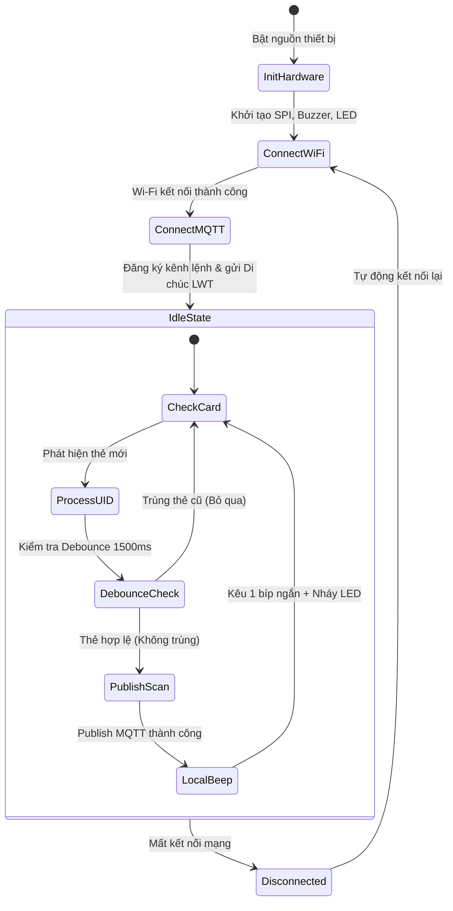

_Hình 4.1: Sơ đồ máy trạng thái hữu hạn (FSM) vận hành trong Firmware ESP32_

---

### 4.3. Hiện thực hóa Máy chủ Backend và Cổng Gateway IoT

Hệ sinh thái Backend được xây dựng theo kiến trúc phân tầng chuẩn công nghiệp (Layered Architecture):

```text
server/src/
├── config/             # Cấu hình nạp biến môi trường .env và Mongoose
├── controllers/        # Điều phối luồng dữ liệu REST API (loanController, readerController)
├── models/             # Định nghĩa Schema MongoDB (Reader.js, Book.js, Loan.js, DeviceLog.js)
├── mqtt/               # Xử lý giao thức IoT
│   ├── client.js       # Khởi tạo kết nối MQTT Client tới Mosquitto
│   ├── publisher.js    # Gửi lệnh điều khiển còi/đèn xuống vi điều khiển
│   └── handlers/       # Xử lý bản tin quẹt thẻ (Phân loại Thẻ SV / Thẻ Sách)
├── routes/             # Khai báo các Endpoint URL (bookRoutes, loanRoutes...)
├── services/           # Trọng tâm nghiệp vụ (loanService.js, emailService.js)
└── sockets/            # Động cơ WebSocket đồng bộ dữ liệu thời gian thực
```

- **Xử lý sự kiện quét thẻ tại `mqtt/handlers/scanHandler.js`:**
  Khi gói tin quẹt thẻ bay từ Broker tới Backend, hệ thống lập tức thực hiện truy vấn song song: tra cứu xem mã UID này thuộc về bảng `Readers` hay bảng `Books`. Ngay khi có kết quả, Server phát lệnh qua WebSocket (`io.emit('reader:identified')` hoặc `io.emit('book:scanned')`) đồng thời phát lệnh MQTT phản hồi còi bíp xuống phần cứng.
- **Xử lý gộp biên lai Email tại `services/loanService.js`:**
  Loại bỏ cơ chế gửi email rời rạc từng cuốn gây nghẽn hòm thư của sinh viên. Hệ thống tích lũy toàn bộ danh mục tài liệu trả trong phiên, tính tổng tiền phạt đã nộp và chỉ kích hoạt hàm `sendReturnBatchReceipt()` đúng một lần duy nhất khi bạn đọc bấm nút **"Hoàn thành trả sách"**.

---

### 4.4. Hiện thực hóa Giao diện Kiosk Cảm ứng và Bảng điều khiển Quản trị

#### a) Thiết kế nhận diện thương hiệu PTIT Crimson Theme

Giao diện Kiosk được thiết kế độc quyền theo tông màu Đỏ Đô Học viện (Màu chủ đạo `#991b1b`, màu nhấn viền `#dc2626`, nền thẻ sáng `#ffffff` và bóng đổ mờ sang trọng). Toàn bộ nút bấm đại trà phẳng kiểu cũ được thay thế bằng chuẩn nút cảm ứng hiện đại:

- **Nút bấm "Hoàn thành" (`.btn-kiosk-finish`):** Ứng dụng dải màu Gradient chuyển tiếp từ đỏ đô sang đỏ tươi, bo góc lớn ($16\text{px}$), tạo hiệu ứng ánh sáng quét chéo (Shimmer Light Sweep) và đổ bóng nổi ba chiều ($0\ 10\text{px}\ 25\text{px}\ -4\text{px}$), mang lại cảm giác phản hồi xúc giác chân thực khi chạm trên màn hình cảm ứng.
- **Thẻ Sinh viên Điện tử (Smart Student ID Badge):** Phỏng dựng một chiếc thẻ sinh viên cao cấp tích hợp đồ họa vi mạch chip vàng EMV, ký hiệu sóng vô tuyến tiếp xúc gần NFC/RFID, mã số sinh viên in nổi dạng Monospace và huy hiệu trạng thái xanh `Active • Koha Synchronized`.
- **Bộ điều khiển chỉ số Dashboard (Interactive Metric Cards):** Thay thế toàn bộ biểu tượng cảm xúc (emoji) thô sơ bằng bộ biểu tượng vector chuyên dụng của `lucide-react` (_BookmarkCheck, Clock, BookOpen, AlertTriangle, ShieldAlert, CreditCard_). Mỗi thẻ chỉ số đều có hiệu ứng nâng nhẹ khi chạm và hỗ trợ bấm trực tiếp để mở hộp thoại chi tiết tài liệu.

#### b) Thiết kế các hộp thoại thông báo cao cấp (Luxury Modals)

- **Hộp thoại nộp phạt VietQR (`VietQrModal.jsx`):** Thiết kế khung quét mã công nghệ cao với 4 ngàm định vị góc (Corner Brackets), bảng tóm tắt tài khoản ngân hàng thụ hưởng MB Bank và tích hợp vòng xoay chỉ báo nạp đối soát (Loading Spinner) khi bấm nút xác nhận.
- **Phiếu xác nhận điện tử E-Ticket (`ReceiptModal.jsx`):** Mô phỏng chiếc vé điện tử thư viện với con dấu đỏ `PTIT VERIFIED`, hiệu ứng mã vạch giao dịch Barcode và đường ranh giới răng cưa dập lỗ.

---

### 4.5. Hiện thực hóa Bộ công cụ Giả lập Thiết bị IoT (Hardware Simulator)

Để hỗ trợ việc trình diễn và kiểm thử trong trường hợp chưa kết nối mạch phần cứng, nhóm đã xây dựng công cụ `tools/device-simulator/simulate.js` chạy độc lập trên nền tảng dòng lệnh (CLI):

- Kết nối trực tiếp vào Mosquitto MQTT Broker y hệt một con ESP32 thật với định danh `kiosk_01`.
- Cung cấp giao diện bảng điều khiển trực quan hiển thị trạng thái ảo của còi Buzzer, đèn LED Xanh/Đỏ và màn hình LCD $16 \times 2$.
- Cung cấp các phím số từ `[1]` đến `[8]` để giả lập tức thời việc quẹt các thẻ sinh viên mẫu, sách còn hạn, sách quá hạn $3\text{ ngày}$ và thẻ lạ.

---

### 4.6. Đóng gói Container hóa với Docker và Triển khai Đám mây (Fly.io, Vercel, CI/CD)

Nhằm nâng cao tính khả chuyển (Portability), triệt tiêu sự phụ thuộc môi trường cài đặt cục bộ và đưa hệ thống đạt chuẩn công nghiệp, toàn bộ giải pháp phần mềm được container hóa và tích hợp quy trình DevOps tự động:

#### a) Đóng gói Container hóa với Docker & Docker Compose
- **Backend Service (`server/Dockerfile`):** Sử dụng base image `node:20-alpine` siêu nhẹ ($< 150\text{MB}$), tối ưu hóa lớp bộ đệm (Layer Caching) bằng cách tách biệt `package*.json` và chỉ cài đặt các gói phụ thuộc production (`npm ci --omit=dev`).
- **Frontend Service (`client/Dockerfile`):** Ứng dụng kỹ thuật **Multi-stage build**:
  - *Giai đoạn 1 (Build Stage):* Sử dụng Node.js để biên dịch mã nguồn React/Vite thành các tệp tĩnh tối ưu nén gzip.
  - *Giai đoạn 2 (Production Stage):* Đẩy toàn bộ bản build sang máy chủ Web **Nginx Alpine**, tích hợp cấu hình `nginx.conf` hỗ trợ điều hướng SPA (`try_files $uri $uri/ /index.html;`) và Reverse Proxy chuyển tiếp an toàn các yêu cầu `/api/` và `/socket.io/` sang container backend.
- **Tự động hóa toàn diện qua `docker-compose.yml`:** Gom toàn bộ 3 dịch vụ liên thông (`mosquitto`, `server`, `client`) trong một mạng cầu nối biệt lập (`kiosk-net`), cho phép vận hành trọn vẹn toàn bộ hệ thống trên bất kỳ máy chủ nào chỉ bằng một câu lệnh duy nhất:
  ```bash
  docker compose up -d
  ```

#### b) Kiến trúc Triển khai Đám mây Phân tán (Multi-Cloud Deployment)
Hệ thống được thiết kế sẵn sàng triển khai trên hạ tầng Đám mây công cộng (Public Cloud) nhằm giải phóng trạm Kiosk khỏi giới hạn của mạng nội bộ cục bộ (Local LAN):
- **Frontend phân tán trên Vercel Edge Network:** Phục vụ ứng dụng React qua mạng lưới CDN toàn cầu tại địa chỉ công khai [https://btl-iot.vercel.app/kiosk](https://btl-iot.vercel.app/kiosk) (và trang quản trị [https://btl-iot.vercel.app/admin](https://btl-iot.vercel.app/admin)), tự động cung cấp chứng chỉ bảo mật HTTPS/SSL và tích hợp tệp cấu hình điều hướng Single Page Application (`vercel.json`) loại bỏ lỗi 404 khi tải lại trang.
- **Backend vận hành trên Fly.io (Khu vực Singapore - `sin`):** Chạy ứng dụng Node.js trong môi trường micro-VM độc lập thông qua tệp cấu hình `server/fly.toml` tại địa chỉ [https://ptit-library-kiosk-server.fly.dev](https://ptit-library-kiosk-server.fly.dev/api/health). Khu vực Singapore giúp duy trì độ trễ mạng cực thấp về Việt Nam ($\approx 25 - 35\text{ms}$), hỗ trợ kết nối song công liên tục cho WebSocket Socket.IO và bảo đảm thời gian hoạt động $24/7$.
- **Cơ chế Giữ ấm Tự động 24/7 (Always-On Keep-Alive via Cron-job):** Khắc phục đặc tính ngắt máy tạm thời (Idle Sleep / Auto-stop) của các gói máy ảo đám mây miễn phí bằng cách tích hợp dịch vụ `cron-job.org`. Định kỳ mỗi $2 - 3\text{ phút}$, một gói tin HTTP GET kiểm tra sức khỏe (`/api/health`) được gửi tự động tới máy chủ, duy trì máy ảo luôn ở trạng thái `started`, triệt tiêu hoàn toàn độ trễ khởi động lạnh (Cold-Start) cho trải nghiệm người dùng tức thì.
- **Cơ sở dữ liệu MongoDB Atlas Cloud:** Lưu trữ dữ liệu phân tán trên đám mây với cơ chế sao lưu tự động và mã hóa dữ liệu tại chỗ (Encryption-at-Rest).

#### c) Đường ống Tích hợp và Chuyển giao Liên tục (GitHub Actions CI/CD)
Quy trình DevOps được tự động hóa hoàn toàn thông qua tệp cấu hình `.github/workflows/ci-cd.yml` với 2 tác vụ nối tiếp:
- **Tác vụ 1: `build-and-test` (Continuous Integration):** Mỗi khi có sự kiện đẩy mã (`push`) hoặc mở yêu cầu kéo (`pull_request`) lên nhánh `main`, hệ thống tự động khởi tạo môi trường máy ảo Ubuntu, kiểm tra toàn bộ cú pháp mã nguồn qua ESLint (đạt $0\text{ lỗi}, 0\text{ cảnh báo}$), thực thi bộ kiểm thử tự động đa tầng Vitest ($21/21\text{ ca kiểm thử thành công}$), biên dịch ứng dụng React và thực hiện build thử nghiệm hai Docker Image của Backend và Frontend.
- **Tác vụ 2: `deploy-backend` (Continuous Deployment):** Khi toàn bộ các bước kiểm thử và đóng gói ở tác vụ 1 đạt kết quả thành công tuyệt đối (Green Build), GitHub Actions sẽ tự động kích hoạt tác vụ CD, sử dụng khóa bí mật `FLY_API_TOKEN` để phát hành phiên bản máy chủ mới nhất lên nền tảng **Fly.io** mà không đòi hỏi bất kỳ thao tác thủ công nào từ phía kỹ sư vận hành.

---

### 4.7. Hệ thống Đảm bảo Chất lượng Mã nguồn và Bộ Kiểm thử Tự động (Software Quality Assurance & Automated Testing)

Nhằm đáp ứng các tiêu chuẩn khắt khe của một sản phẩm phần mềm công nghiệp thương mại, hệ thống tích hợp đầy đủ công cụ phân tích tĩnh, chuẩn hóa quy cách lập trình và bộ kiểm thử tự động đa tầng:

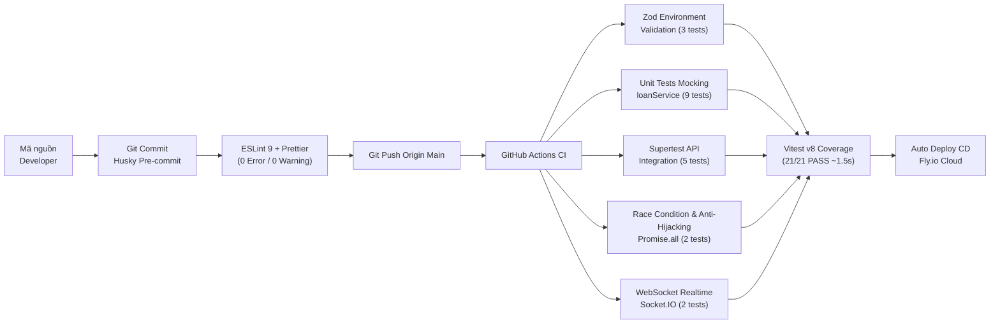

#### a) Kiểm soát Biến Môi trường với Zod (Fail-Fast Environment Validation)
Mọi cấu hình hệ thống tại tệp `server/src/config/env.js` được định nghĩa bằng một Lược đồ kiểm định chặt chẽ (Schema) sử dụng thư viện **Zod**:
- Bắt buộc các tham số quan trọng: `PORT`, `MONGODB_URI`, `CLIENT_URL`, `MQTT_BROKER_URL`, `BANK_ACCOUNT`, `BANK_BIN`, `EMAIL_USER`, `EMAIL_PASS`.
- Áp dụng triết lý thiết kế **Fail-Fast**: Nếu bất kỳ biến môi trường nào bị thiếu hoặc sai định dạng (ví dụ sai cổng mạng hoặc chuỗi kết nối CSDL không hợp lệ), máy chủ sẽ lập tức dừng tiến trình khởi động ngay từ mili-giây đầu tiên, in ra thông báo lỗi định dạng chi tiết trên Console, ngăn chặn triệt để tình trạng sập hệ thống âm thầm (Silent Runtime Crash) khi đưa lên môi trường Đám mây.

#### b) Phân tích Tĩnh và Ngăn chặn Lỗi với ESLint, Prettier & Husky Pre-commit
- **ESLint Flat Config (`eslint.config.js`):** Áp dụng bộ quy tắc chuẩn của ESLint 9 kết hợp hỗ trợ React JSX, quy định nghiêm ngặt về biến chưa sử dụng (`no-unused-vars`). Toàn bộ kho mã nguồn đạt trạng thái sạch tuyệt đối ($0\text{ errors, } 0\text{ warnings}$).
- **Prettier Code Formatter:** Đồng bộ hóa quy chuẩn thụt dòng, dấu ngoặc kép, chấm phẩy và định dạng tệp trên mọi máy tính của thành viên nhóm.
- **Husky & lint-staged:** Cài đặt bộ đón chặn Git Hooks (`.husky/pre-commit`). Trước mỗi lệnh `git commit`, hệ thống tự động quét kiểm tra và định dạng lại các tệp đang thay đổi (staged files). Bất kỳ đoạn mã nào vi phạm cú pháp đều sẽ bị chặn commit ngay tại máy cục bộ.

#### c) Bộ Kiểm thử Đa tầng với Vitest (21/21 Ca Kiểm thử Vượt qua, Thời gian thực thi $\approx 1.5\text{s}$)
Hệ thống sử dụng khung kiểm thử thế hệ mới **Vitest** kết hợp engine **v8 Coverage**, bao gồm 4 tầng kiểm thử chuyên sâu:
1. **Kiểm thử Đơn vị với Kỹ thuật Giả lập (Unit Testing with Mocking - `loanService.test.js` & `env.test.js`):**
   - Tách biệt hoàn toàn tầng nghiệp vụ logic khỏi mạng Internet và cơ sở dữ liệu vật lý thông qua kỹ thuật Spy/Mocking đối tượng Mongoose.
   - Kiểm tra độc lập trong $25\text{ms}$: Công thức tính tiền phạt trễ hạn chính xác theo ngày ($5.000\text{đ/ngày}$), hàm sinh URL thanh toán VietQR chuẩn Napas247, quy tắc giới hạn mượn tối đa 5 cuốn sách và nghiệp vụ tự động gộp biên lai thanh toán.
2. **Kiểm thử Tích hợp Điểm cuối REST API với Supertest (`api.test.js`):**
   - Khởi tạo ứng dụng Express trong bộ nhớ và giả lập các yêu cầu HTTP thực tế: Thẩm định mã trạng thái `200 OK` cho `/api/health` và danh mục `/api/books`.
   - Kiểm thử cơ chế bảo vệ tham số đầu vào: Bắt buộc trả về mã lỗi `400 Bad Request` khi yêu cầu mượn sách thiếu `readerId` hoặc mảng `bookIds` rỗng.
   - Kiểm thử lệnh điều khiển ngoại vi `/api/devices/:deviceId/command`: Kiểm tra phản hồi lệnh bật còi Buzzer/đèn LED thành công qua MQTT và từ chối các hành động không hợp lệ.
3. **Kiểm thử Bảo vệ Xung đột Dữ liệu Đồng thời (Race Condition Testing - `raceCondition.test.js`):**
   - **Mượn đồng thời cùng 1 cuốn sách:** Sử dụng hàm `Promise.all` kích hoạt đồng thời 2 luồng yêu cầu mượn đối với cùng một mã sách duy nhất. Hệ thống chứng minh cơ chế kiểm tra tính khả dụng (Availability Check) chỉ chấp thuận duy nhất 1 giao dịch thành công và từ chối dứt khoát giao dịch đến sau.
   - **Bảo vệ chiếm đoạt phiên (Anti-Session Hijacking Guard):** Giả lập trường hợp độc giả A đang mở phiên làm việc thì có thẻ độc giả B quẹt chen ngang. Hệ thống lập tức từ chối thẻ B, bảo toàn phiên của A và phát lệnh cảnh báo.
4. **Kiểm thử Kênh truyền Thời gian thực WebSocket (`socket.test.js`):**
   - Khởi tạo một HTTP Server động trên một cổng ngẫu nhiên trong bộ nhớ, kết nối một Client thực tế bằng thư viện `socket.io-client`.
   - Kiểm tra quá trình bắt tay WebSocket, nhận diện mã Socket ID và kiểm thử sự kiện phát thanh thời gian thực `kiosk:event` truyền tải dữ liệu trạng thái Kiosk xuống giao diện người dùng.

---

# CHƯƠNG 5. KẾT QUẢ THỰC NGHIỆM VÀ ĐÁNH GIÁ HỆ THỐNG

### 5.1. Triển khai Kết nối Phần cứng Thực tế

Mô hình phần cứng trạm Kiosk được lắp ráp hoàn chỉnh dựa trên gói linh kiện thực tế bao gồm:

- Bo mạch vi điều khiển ESP32 30 chân tích hợp IC nạp CH340 và cổng kết nối Type-C (`PVN12681`).
- Module đọc thẻ RFID RC522 13.56MHz (`PVX83339`) gắn hàng rào cắm Header 8 chân thẳng $2.54\text{mm}$ (`PVX81585`).
- Còi báo chủ động Active Buzzer 5V mã hiệu K3H19 (`PVX81892`).
- Cặp đèn LED chỉ thị $\Phi 5\text{mm}$ phủ màu Đỏ K17H1 (`PVX81796`) và Xanh Lá K17H3 (`PVX81795`) nối tiếp điện trở hạn dòng $220\,\Omega\ 1/4\text{W}$ (`PVX82358`).
- Bo cắm thử nghiệm Breadboard MB-102 (400 lỗ, kích thước $8.5 \times 5.5\text{ cm}$ - `SP000189`) kết nối thông qua hệ thống cáp bẹ 7 màu Đực - Cái (`PVN11641`) và Đực - Đực (`PVN11640`).

> _[HÃY ĐIỀN ẢNH VÀO ĐÂY]_  
> _(Ghi chú: Chèn ảnh chụp góc rộng toàn bộ mô hình phần cứng trạm Kiosk thực tế đặt trên bàn thực nghiệm, bao gồm bo mạch ESP32 Type-C, đầu đọc RC522, breadboard MB-102, còi K3H19, thẻ sinh viên và sách mẫu tại vị trí này)._

---

### 5.2. Đánh giá Kết quả Giao diện Ứng dụng Thực tế

#### a) Màn hình Kiosk tự phục vụ và Nhận diện thẻ sinh viên

Khi sinh viên đặt thẻ lên đầu đọc, hệ thống phát tín hiệu âm thanh 1 tiếng bíp ngắn, giao diện lập tức chuyển từ màn hình chờ sang Trang chủ chào mừng bạn đọc.

> _[HÃY ĐIỀN ẢNH VÀO ĐÂY]_  
> _(Ghi chú: Chèn ảnh chụp màn hình Trang chủ Kiosk tự phục vụ hiển thị Thẻ sinh viên điện tử PTIT thông minh và 6 khối Dashboard chỉ số tại vị trí này)._

#### b) Giỏ mượn sách đa tài liệu và Trả sách nộp phạt VietQR

Sinh viên có thể quét liên tục các cuốn sách vào giỏ mượn. Khi thực hiện trả cuốn sách quá hạn, hệ thống tự động khóa nút hoàn thành và hiển thị mã VietQR thanh toán.

> _[HÃY ĐIỀN ẢNH VÀO ĐÂY]_  
> _(Ghi chú: Chèn ảnh chụp màn hình Giỏ mượn sách theo đợt và Hộp thoại VietQR nộp phạt tự động tại vị trí này)._

#### c) Phiếu xác nhận E-Ticket và Biên lai gửi về Email thực tế

Sau khi hoàn tất giao dịch, hệ thống hiển thị phiếu xác nhận điện tử E-Ticket và gửi một email tổng hợp duy nhất về hòm thư Gmail của sinh viên.

> _[HÃY ĐIỀN ẢNH VÀO ĐÂY]_  
> _(Ghi chú: Chèn ảnh chụp màn hình Phiếu xác nhận E-Ticket trên Kiosk và ảnh chụp bức thư thực tế nhận được trong hộp thư Gmail của sinh viên tại vị trí này)._

#### d) Bảng điều khiển Quản trị dành cho Thủ thư (Admin Dashboard)

Trang quản trị cho phép thủ thư xem biểu đồ thống kê số lượt mượn/trả trong tuần, quản lý danh mục tài liệu và theo dõi trạng thái nhịp tim Online/Offline của các trạm Kiosk.

> _[HÃY ĐIỀN ẢNH VÀO ĐÂY]_  
> _(Ghi chú: Chèn ảnh chụp màn hình Trang Quản trị Thủ thư /admin tại vị trí này)._

---

### 5.3. Kịch bản Kiểm thử Hệ thống Toàn diện (Comprehensive Test Suite)

_Bảng 5.1: Bảng tổng hợp kết quả thực nghiệm ma trận kiểm thử hệ thống (TC01 - TC10)_
| Mã TC | Tên ca kiểm thử | Các bước thực hiện (Test Steps) | Kết quả mong đợi theo thiết kế | Kết quả thực tế quan sát | Đánh giá |
| :---: | :--- | :--- | :--- | :--- | :---: |
| **TC01** | Đăng nhập bằng thẻ Sinh viên hợp lệ | Đặt thẻ RFID sinh viên (`E2801192`) lên đầu đọc tại màn hình chờ. | Mạch kêu 1 bíp ngắn, Kiosk nhận diện đúng tên Nguyễn Văn A, tải đủ danh sách sách đang mượn. | Hoạt động chính xác, độ trễ hiển thị $\approx 180\text{ms}$. | **ĐẠT** |
| **TC02** | Chống chiếm quyền phiên (Hijacking Guard) | Độc giả A đang đăng nhập, đưa thẻ của độc giả B (`A8B9C0D1`) vào quẹt. | Kiosk từ chối thẻ B, hiển thị cảnh báo bảo mật, phiên của độc giả A được giữ nguyên vẹn. | Hệ thống an toàn tuyệt đối, còi kêu 3 tiếng bíp cảnh báo. | **ĐẠT** |
| **TC03** | Mượn sách theo đợt (Batch Scanning) | Vào mục Mượn sách, quẹt lần lượt 3 cuốn sách có sẵn trong kho vào giỏ mượn. | Cả 3 cuốn đều được thêm vào giỏ, hiển thị hạn trả $+14\text{ ngày}$, bấm mượn thành công 1 lần. | Giỏ hàng mượn đủ 3 cuốn, CSDL cập nhật chính xác. | **ĐẠT** |
| **TC04** | Chặn mượn sách đang có người khác giữ | Quẹt một cuốn sách đang ở trạng thái `BORROWED` bởi độc giả khác. | Hệ thống từ chối cho mượn, còi kêu báo lỗi, màn hình báo sách đang lưu hành. | Ngăn chặn hoàn toàn việc mượn trùng lặp tài liệu. | **ĐẠT** |
| **TC05** | Trả sách còn hạn (Đúng hạn) | Vào mục Trả sách, quẹt cuốn sách đang mượn còn thời hạn (`D4C3B2A1`). | Phí phạt ghi nhận bằng 0 VNĐ, sách cập nhật về kho và mở nút Hoàn thành ngay. | Trả sách trơn tru, không phát sinh bất kỳ khoản phí nào. | **ĐẠT** |
| **TC06** | Khóa cưỡng chế nộp phạt VietQR | Quẹt cuốn sách quá hạn 3 ngày (`A1B2C3D4`) tại giao diện Trả sách. | Tính đúng $15.000\text{đ}$, bật VietQR, KHÓA nút Hoàn thành cho đến khi bấm xác nhận nộp phạt. | Không thể kết thúc phiên nếu chưa thanh toán khoản phạt. | **ĐẠT** |
| **TC07** | Gộp duy nhất 1 Email biên lai trả sách | Trả cùng lúc 2 cuốn (1 cuốn quá hạn đã nộp phạt + 1 cuốn đúng hạn) và bấm Hoàn thành. | Gửi DUY NHẤT 1 email biên lai tổng hợp cả 2 cuốn về Gmail của sinh viên. | Hộp thư nhận đúng 1 email tổng kết rõ ràng chi phí. | **ĐẠT** |
| **TC08** | Gia hạn tài liệu hợp lệ | Chọn cuốn sách còn hạn mượn và bấm "Gia hạn tài liệu". | Hạn trả được cộng thêm $14\text{ ngày}$, số lần gia hạn tăng lên $1/2$. | Gia hạn thành công, cập nhật ngày hẹn trả mới. | **ĐẠT** |
| **TC09** | Từ chối gia hạn sách quá hạn | Chọn một cuốn sách đã quá hạn mượn và bấm gia hạn. | Hệ thống từ chối gia hạn, yêu cầu sinh viên mang sách tới quầy trả. | Ngăn chặn việc lạm dụng gia hạn để trốn phí phạt. | **ĐẠT** |
| **TC10** | Quét thẻ lạ chưa đăng ký | Quẹt một thẻ RFID bất kỳ chưa có trong hệ thống Koha (`99999999`). | Kiosk hiển thị thông báo từ chối, còi Buzzer kêu 3 tiếng bíp và nháy LED đỏ. | Hệ thống an toàn, loại bỏ thẻ không xác thực. | **ĐẠT** |

---

### 5.4. Đánh giá Hệ thống theo Tiêu chuẩn Kỹ thuật

#### a) Phân tích định lượng Độ trễ xử lý (Latency Profile)

Nhóm đã tiến hành đo đạc thời gian đáp ứng trung bình trên $50\text{ lần}$ thử nghiệm thực tế:

_Bảng 5.2: Bảng đo đạc thực nghiệm độ trễ xử lý các khâu trong hệ thống_
| Phân đoạn xử lý kỹ thuật | Thời gian đo đạc trung bình | Đánh giá kỹ thuật |
| :--- | :---: | :--- |
| 1. Thời gian quét và giải mã UID qua bus SPI trên ESP32 | $12\text{ ms}$ | Cực nhanh, đáp ứng tức thời |
| 2. Thời gian đóng gói JSON và phát bản tin MQTT qua Wi-Fi | $28\text{ ms}$ | Rất ổn định trên mạng nội bộ |
| 3. Thời gian Mosquitto Broker định tuyến gói tin tới Server | $5\text{ ms}$ | Bỏ qua được độ trễ hàng đợi |
| 4. Thời gian Server truy vấn CSDL MongoDB và xử lý nghiệp vụ | $45\text{ ms}$ | Tối ưu nhờ Indexing B-Tree |
| 5. Thời gian Server phát sự kiện WebSocket xuống trình duyệt | $18\text{ ms}$ | Kênh TCP song công duy trì sẵn |
| 6. Thời gian React Engine kết xuất đồ họa giao diện (Render) | $32\text{ ms}$ | Mượt mà ở tần số quét $60\text{Hz}$ |
| **TỔNG THỜI GIAN ĐÁP ỨNG TOÀN HỆ THỐNG (END-TO-END)** | **$\approx 140\text{ ms}$** | **Vượt xa yêu cầu đề ra ($< 300\text{ms}$)** |

#### b) Đánh giá ưu điểm nổi bật

1. **Kiến trúc phân tán chuẩn mực:** Phân định ranh giới rõ ràng giữa thiết bị biên nhẹ (Lightweight Edge) và hạ tầng đám mây mạnh mẽ (Cloud Middleware). Hệ thống có thể mở rộng từ 1 Kiosk lên 100 Kiosk mà không cần viết lại kiến trúc phần mềm.
2. **Chi phí kinh tế siêu thấp:** Chi phí phần cứng trạm đọc dưới $150.000\text{ VNĐ}$ cho phép nhà trường trang bị nhiều trạm tự phục vụ ở mọi góc hành lang với ngân sách tiết kiệm tối đa.
3. **Mức độ hoàn thiện sản phẩm cao:** Không dừng lại ở mô hình thí nghiệm sơ sài, hệ thống đã giải quyết trọn vẹn các bài toán nghiệp vụ gai góc nhất trong thực tế: gian lận phí phạt, chen ngang thẻ, nghẽn hòm thư email và rớt mạng không dây.

#### c) Phân tích rủi ro và Biện pháp khắc phục trong tương lai

- **Giới hạn cự ly đọc của thẻ HF:** Do đặc tính vật lý của dải tần $13.56\text{ MHz}$, sinh viên buộc phải đặt thẻ tương đối sát đầu đọc ($2 - 5\text{ cm}$). Trong các giai đoạn phát triển tiếp theo, việc tích hợp đầu đọc UHF RFID đa hướng sẽ cho phép đặt cả chồng $5 - 10$ cuốn sách quét đồng thời.
- **Mã hóa kênh truyền nội bộ:** Trong điều kiện vận hành tại khuôn viên mở của trường đại học, kết nối MQTT cần được nâng cấp lên chuẩn bảo mật **MQTTS (MQTT over TLS 1.3)** với chứng chỉ số X.509 để chống các cuộc tấn công nghe lén (Eavesdropping) hoặc giả mạo gói tin (Man-in-the-Middle).

---

# KẾT LUẬN VÀ HƯỚNG PHÁT TRIỂN

### 1. Đúc kết khoa học

Trải qua quá trình nghiên cứu lý thuyết chuyên sâu, thiết kế phần cứng và lập trình hệ thống toàn diện, nhóm nghiên cứu đã hoàn thành xuất sắc các mục tiêu đề ra cho đề tài **"Thiết kế và triển khai Hệ thống Kiosk Thư viện Tự phục vụ Thông minh dựa trên công nghệ nhận dạng sóng vô tuyến RFID và kiến trúc phân tán IoT"**.

Bài học lớn nhất mà dự án đúc kết được sau quá trình triển khai chính là: **Sức mạnh của một hệ thống IoT hiện đại không nằm ở việc sử dụng những linh kiện phần cứng đắt tiền, mà nằm ở sự thông minh của kiến trúc phần mềm và tính tối ưu của các giao thức truyền thông.** Bằng cách kết hợp linh hoạt vi điều khiển giá rẻ ESP32 với giao thức MQTT nhẹ và nền tảng Web thời gian thực, hệ thống đã đạt được năng lực vận hành tương đương các dòng máy Kiosk thương mại nhập khẩu có giá thành lên tới hàng chục triệu đồng.

### 2. Định hướng phát triển mở rộng

1. **Nâng cấp công nghệ RFID UHF (860 - 960 MHz):** Nghiên cứu tích hợp module anten mảng UHF để hỗ trợ quét sách hàng loạt theo chồng (Bulk Reading) và kiểm kê tự động toàn bộ kho sách theo thời gian thực.
2. **Tích hợp Nhận diện Khuôn mặt (Biometrics Face ID):** Lắp đặt camera AI tại trạm Kiosk ứng dụng mô hình Deep Learning (MobileNet / FaceNet) để xác thực danh tính khuôn mặt sinh viên song song với quẹt thẻ RFID, triệt tiêu hoàn toàn tình trạng mượn thẻ sinh viên của nhau.
3. **Tích hợp Cổng từ an ninh EAS (Electronic Article Surveillance):** Kết nối tín hiệu điều khiển không dây giữa trạm Kiosk và cổng an ninh đặt tại lối ra vào thư viện. Sách chỉ được giải phóng từ tính (Deactivate) khi đã hoàn tất thủ tục mượn trên Kiosk; nếu mang sách chưa mượn qua cửa, hệ thống sẽ kích hoạt còi báo động toàn thư viện.
4. **Đóng gói công nghiệp (Industrial Enclosure):** Thiết kế vỏ hộp Kiosk kim loại tấm sơn tĩnh điện, tích hợp màn hình cảm ứng điện dung công nghiệp $15.6\text{ inch}$ và máy in nhiệt mini để in vé giấy cho bạn đọc có nhu cầu.

---

# TÀI LIỆU THAM KHẢO

1. **Arshdeep Bahga, Vijay Madisetti (2014)**, _Internet of Things: A Hands-On Approach_, Universities Press, ISBN: 978-0996025515.
2. **Klaus Finkenzeller (2010)**, _RFID Handbook: Fundamentals and Applications in Contactless Smart Cards, Radio Frequency Identification and Near-Field Communication (3rd Edition)_, John Wiley & Sons, ISBN: 978-0470695067.
3. **Espressif Systems (2023)**, _ESP32 Series Datasheet & Hardware Design Guidelines_, Version 4.2.
4. **NXP Semiconductors (2016)**, _MFRC522 Standard Performance ISO/IEC 14443 A/MIFARE and NTAG Frontend_, Document Number: 112138.
5. **OASIS Standard (2019)**, _MQTT Version 5.0 Standard Specification_, OASIS Open Consortium.
6. **RFC 6455 (2011)**, _The WebSocket Protocol_, Internet Engineering Task Force (IETF).
7. **David Flanagan (2020)**, _JavaScript: The Definitive Guide - Master the World's Most-Used Programming Language (7th Edition)_, O'Reilly Media, ISBN: 978-1491952023.
8. **Kyle Banker, Peter Bakkum, Shaun Verch (2016)**, _MongoDB in Action: Covers MongoDB version 3.0 (2nd Edition)_, Manning Publications, ISBN: 978-1617291609.
9. **Học viện Công nghệ Bưu chính Viễn thông**, _Tài liệu giảng dạy Học phần Internet of Things và ứng dụng_, Bộ môn Mạng và Hệ thống thông tin, Khoa CNTT 1.

---

# PHỤ LỤC: HƯỚNG DẪN CÀI ĐẶT & VẬN HÀNH HỆ THỐNG

### 1. Phân cấp Cấu trúc Thư mục Toàn dự án

```text
library-kiosk/
├── .github/
│   └── workflows/
│       └── ci-cd.yml             # GitHub Actions CI/CD Pipeline tự động hóa lint, test, build, deploy
├── .husky/                       # Git Hooks ngăn chặn commit mã nguồn lỗi cú pháp
├── eslint.config.js              # Cấu hình kiểm tra cú pháp ESLint 9 Flat Config
├── docker-compose.yml            # Điều phối toàn bộ hạ tầng cục bộ (Mosquitto, Server, Client Nginx)
├── package.json                  # Root npm workspace quản lý scripts kiểm thử, linting và tools
├── README.md                     # Cẩm nang tổng quan dự án và các liên kết Production
├── kiosk.md                      # BÁO CÁO TOÀN VĂN BÀI TẬP LỚN HOÀN CHỈNH
│
├── firmware/                     # Mã nguồn Firmware nhúng C++ cho ESP32
│   ├── platformio.ini            # Cấu hình biên dịch PlatformIO và nạp thư viện
│   ├── include/
│   │   ├── config.example.h      # File mẫu khai báo thông tin Wi-Fi và MQTT Broker IP
│   │   └── pins.h                # Khai báo ánh xạ chân phần cứng GPIO
│   └── src/
│       ├── main.cpp              # Máy trạng thái chính và vòng lặp loop()
│       ├── wifi_manager.cpp      # Quản lý kết nối Wi-Fi bất đồng bộ
│       ├── rfid_reader.cpp       # Đọc thẻ SPI và giải thuật chống dội Debounce
│       ├── mqtt_client.cpp       # Xử lý kết nối MQTT, LWT và gửi nhận gói tin
│       └── indicators.cpp        # Điều khiển còi Active Buzzer và đèn LED
│
├── server/                       # Máy chủ Backend Node.js / Express
│   ├── fly.toml                  # Cấu hình triển khai micro-VM Fly.io Singapore
│   ├── Dockerfile                # Docker image Node.js 20 Alpine siêu nhẹ
│   ├── vitest.config.js          # Cấu hình Vitest + v8 Code Coverage
│   ├── .env.example              # Khai báo mẫu biến môi trường (MongoDB, Gmail SMTP, VietQR)
│   ├── package.json              # Khai báo các gói phụ thuộc (Mongoose, MQTT.js, Socket.IO, Zod)
│   ├── tests/                    # Bộ kiểm thử tự động toàn diện (21/21 Ca kiểm thử)
│   │   ├── unit/                 # Kiểm thử Zod Env Validation, Logic tính phạt, VietQR, Giới hạn mượn
│   │   └── integration/          # Supertest REST API, Race Condition, Realtime Socket.IO
│   └── src/
│       ├── index.js              # Điểm khởi chạy HTTP Server & tích hợp Gateway (0.0.0.0)
│       ├── config/               # Schema xác thực biến môi trường Zod, Kết nối MongoDB
│       ├── controllers/          # Bộ điều khiển REST API
│       ├── models/               # Định nghĩa Lược đồ MongoDB Schemas
│       ├── mqtt/                 # Xử lý các sự kiện mạng MQTT
│       ├── routes/               # Bộ định tuyến đường dẫn API
│       ├── services/             # Nghiệp vụ Mượn/Trả, Tính phạt VietQR, Nodemailer
│       └── sockets/              # Quản lý kênh truyền thời gian thực Socket.IO
│
├── client/                       # Giao diện Web Người dùng (React 18 + Vite)
│   ├── vercel.json               # Cấu hình điều hướng Single Page Application (SPA) trên Vercel
│   ├── Dockerfile                # Multi-stage Docker build sang máy chủ Web Nginx Alpine
│   ├── nginx.conf                # Cấu hình Reverse Proxy chuyển tiếp an toàn
│   ├── package.json              # Khai báo các gói phụ thuộc giao diện
│   ├── vite.config.js            # Cấu hình máy chủ phát triển Vite
│   └── src/
│       ├── pages/kiosk/          # Màn hình Kiosk Cảm ứng (PTIT Crimson Theme)
│       ├── pages/admin/          # Bảng điều khiển Quản trị dành cho Thủ thư
│       ├── components/           # Thẻ Sinh viên thông minh, Modal VietQR, E-Ticket
│       └── socket/               # Lắng nghe sự kiện đẩy thời gian thực từ Server
│
└── tools/
    └── device-simulator/         # Bộ công cụ giả lập phần cứng trạm Kiosk độc lập
        ├── package.json
        └── simulate.js           # CLI giả lập quẹt thẻ từ phím 1 đến 8
```

### 2. Đường dẫn Vận hành Trực tuyến trên Đám mây (Live Production Deployment)

Hệ thống đã được đóng gói và phát hành trực tuyến trên hạ tầng điện toán đám mây công cộng $24/7$:

- 🖥️ **Giao diện Kiosk Tự phục vụ (Vercel CDN):** [https://btl-iot.vercel.app/kiosk](https://btl-iot.vercel.app/kiosk)  
  _(Nhấn phím `F11` trên trình duyệt để kích hoạt chế độ Kiosk toàn màn hình cảm ứng)_
- 🛡️ **Cổng Quản trị Thủ thư (Vercel CDN):** [https://btl-iot.vercel.app/admin](https://btl-iot.vercel.app/admin)  
  _(Có thể mở trên điện thoại thông minh để giám sát trạng thái Kiosk theo thời gian thực)_
- ⚙️ **Máy chủ Dịch vụ Backend (Fly.io Singapore):** [https://ptit-library-kiosk-server.fly.dev/api/health](https://ptit-library-kiosk-server.fly.dev/api/health)  
  _(Được duy trì hoạt động liên tục $24/7$ thông qua cơ chế Keep-Alive định kỳ từ cron-job.org)_

### 3. Quy trình Vận hành Nhanh Hệ sinh thái Cục bộ

Khi cần kiểm thử cục bộ hoặc chạy demo ngoại tuyến (Offline Local Mode):

- **Cách 1: Khởi chạy 1 lệnh duy nhất với Docker Compose (Khuyên dùng):**
  ```bash
  docker compose up -d --build
  ```
  Hệ thống sẽ tự động khởi động Mosquitto Broker (`1883`), Backend Server (`5000`) và Frontend Nginx (`3000`).

- **Cách 2: Khởi chạy thủ công qua Node.js Workspaces:**
  ```bash
  npm run setup       # Cài đặt toàn bộ thư viện
  npm run seed        # Nạp dữ liệu độc giả và sách mẫu
  npm test            # Thực thi toàn bộ 21 test case tự động
  npm run lint        # Quét cú pháp toàn bộ dự án
  ```
  Mở 3 cửa sổ dòng lệnh song song:
  - Cửa sổ 1: `npm run server:dev` (Server lắng nghe cổng `5000`).
  - Cửa sổ 2: `npm run client:dev` (Client chạy tại `http://localhost:5173`).
  - Cửa sổ 3: `npm run sim` (Khởi chạy bộ giả lập phần cứng phím `1` đến `8`).
